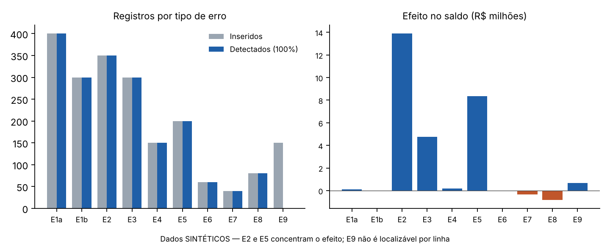

# Introdução ao dossiê

Este dossiê reúne os **27 papéis de trabalho** (Estrutura Conceitual e NBC TA 200 a 600) para as demonstrações financeiras de **31/12/2025 da Bradespar S.A.** (CNPJ 03.847.461/0001-92; tickers BRAP3/BRAP4),
elaborados pelo aluno de matrícula **211014396** como trabalho individual da disciplina. A base de **520.000 registros** é **sintética**. Cada procedimento é classificado como *Realizado com evidência pública*, *Planejado por falta de acesso* ou *Simulado para fins didáticos*.

**Resumo executivo.** O investimento na Vale (R$ 7.344.756 mil; 91,8% do ativo) e a equivalência (R$ 571.264 mil) concentram os riscos. Com evidência pública, as conciliações **fecham**; permanecem pendentes confirmações, controles e o trabalho dos auditores da Vale.
Na base sintética, testes de 100% identificaram 92,6% dos erros inseridos; a amostra MUS de 461 itens teve limite superior de erro de 1.30× a distorção tolerável.

\newpage

# PT-EC — Estrutura Conceitual — trabalho de asseguração: objeto, critérios, usuários e nível de segurança

| Campo | Conteúdo |
|---|---|
| **Código** | PT-EC |
| **Título** | Estrutura Conceitual — trabalho de asseguração: objeto, critérios, usuários e nível de segurança |
| **Norma e itens utilizados** | NBC TA — Estrutura Conceitual para Trabalhos de Asseguração (versão original, DOU 25/11/2015 — ver NORMAS_VERSOES.md) — elementos do trabalho de asseguração (relação entre três partes, objeto, critérios, evidência, relatório); asseguração razoável × limitada |
| **Entidade / período** | Bradespar S.A. (CNPJ 03.847.461/0001-92) — exercício findo em 31/12/2025 (comparativo 2024) |
| **Preparado por** | Matrícula 211014396 — 23/10/2026 |
| **Revisão** | Revisor: ____________ · Data: ____/____/______ *(campo reservado; nenhuma assinatura ou revisão é simulada)* |
| **Classificações presentes neste PT** | Realizado com evidência pública; Simulado para fins didáticos |

> **Aviso:** trabalho acadêmico individual (UnB). Não é auditoria real, não houve contato com a companhia ou seu auditor, e este papel não expressa opinião de auditoria. Dados da base de lotes são **SINTÉTICOS**.

## 1. Objetivo e conta / processo / divulgação
Identificar, a partir do relatório do auditor independente de 24/03/2026 e das notas explicativas, os elementos do trabalho de asseguração realizado sobre as demonstrações financeiras (DFs) da Bradespar S.A. de 31/12/2025 e diferenciar a **auditoria** de outros trabalhos de asseguração, para delimitar o que este dossiê pode (e não pode) concluir.

## 2. Asserções relevantes e riscos
Risco de **conclusão inadequada para o nível de segurança**: apresentar como 'auditoria' um trabalho de procedimentos limitados, ou supor segurança razoável sem evidência suficiente. Asseguração aplica-se à informação sobre o objeto (as DFs) como um todo.

## 3. População, fontes e critérios de seleção
Fontes: Relatório do auditor independente (DF p.42–46; DFP p.45–47); Nota 2 — critérios (DF p.20); Parecer do Conselho Fiscal (DFP p.48); Declarações dos diretores (DFP p.49–50). Seleção: documentos públicos entregues pelo aluno e protocolados na CVM (arquivos em `fontes/`).

## 4. Procedimentos planejados e executados
| Ref. | Procedimento | Classificação | Situação |
|---------|-------------------------------------------|------------------------|------------------------|
| EC-1 | Identificar as três partes: auditor (Baker Tilly 4Partners Auditores Independentes), parte responsável (administração/Conselho de Administração) e usuários previstos (acionistas, mercado, CVM). | Realizado com evidência pública | Executado |
| EC-2 | Identificar o objeto: DFs individuais de 31/12/2025 (balanço, DRE, DRA, DMPL, DFC, notas) e DVA como informação suplementar. | Realizado com evidência pública | Executado |
| EC-3 | Identificar critérios: práticas contábeis adotadas no Brasil (CPC/Res. CVM 72) e IFRS Accounting Standards (Nota 2). | Realizado com evidência pública | Executado |
| EC-4 | Identificar nível de segurança: segurança razoável (alto nível, não garantia) — relatório de auditoria com opinião sem ressalvas. | Realizado com evidência pública | Executado |
| EC-5 | Distinguir auditoria de: revisão de informações trimestrais (limitada), asseguração diferente de auditoria/revisão (ex.: dados de sustentabilidade) e procedimentos previamente acordados (sem asseguração). | Realizado com evidência pública | Executado (análise conceitual) |
| EC-6 | Confirmar que o escopo do **dossiê do aluno** é de trabalho acadêmico: não emite relatório nem expressa opinião. | Simulado para fins didáticos | Executado |

## 5. Evidências e referências cruzadas
- Evidência EC-1..EC-4: relatório do auditor (DF p.42: 'Opinião'; p.42: 'Base para opinião'; p.45: 'Responsabilidades do auditor').
- Evidência EC-3: Nota 2 (DF p.20). Evidência complementar: Conselho Fiscal e diretores (DFP p.48–50).
- Referências cruzadas: PT-200 (objetivos do auditor), PT-210 (termos do trabalho), PT-500 (evidência), PT-580 (representações).

## 6. Resultados e exceções
**Quadro comparativo** (preenchido pelo preparador):

| Elemento | Auditoria das DFs (caso Bradespar) | Revisão de ITR | Asseguração (ex.: sustentabilidade) | Dossiê do aluno |
|----------|--------------------------|----------------|---------------------------|---------------------|
| Partes | Auditor × administração × usuários | Idem | Idem | Aluno × (nenhuma parte real) |
| Objeto | DFs anuais 31/12/2025 | Informações trimestrais | Informação não financeira | Dados públicos + base sintética |
| Critérios | CPC / IFRS Accounting Standards | Idem | Critérios específicos do tema | NBC TA (estudo) |
| Nível | Razoável (positivo) | Limitada (negativa) | Razoável ou limitada | Nenhum (sem opinião) |
| Evidência | Suficiente e apropriada (NBC TA 500) | Indagação e analíticos | Conforme o trabalho | Pública/simulada (PT-500) |
| Produto | Relatório com opinião (DF p.42) | Relatório de revisão | Relatório de asseguração | Dossiê e conclusão integrada (sem opinião) |

## 7. Conclusão
O relatório de 24/03/2026 contém os cinco elementos da Estrutura Conceitual e indica segurança **razoável**. O dossiê do aluno **não** é trabalho de asseguração: reproduz o raciocínio e as conclusões parciais com evidência pública e dados sintéticos, sem emitir opinião sobre as DFs.

## 8. Limitações
Não foi acessada a carta de contratação real nem a documentação do auditor; os elementos são inferidos do relatório publicado. O texto integral da norma não foi transcrito (ver NORMAS_VERSOES.md).

\newpage

# PT-200 — Objetivos gerais, ética, independência, ceticismo, julgamento e risco de auditoria

| Campo | Conteúdo |
|---|---|
| **Código** | PT-200 |
| **Título** | Objetivos gerais, ética, independência, ceticismo, julgamento e risco de auditoria |
| **Norma e itens utilizados** | NBC TA 200 (R1) — objetivos gerais; requisitos éticos; ceticismo e julgamento profissionais; segurança razoável; risco de auditoria |
| **Entidade / período** | Bradespar S.A. (CNPJ 03.847.461/0001-92) — exercício findo em 31/12/2025 (comparativo 2024) |
| **Preparado por** | Matrícula 211014396 — 23/10/2026 |
| **Revisão** | Revisor: ____________ · Data: ____/____/______ *(campo reservado; nenhuma assinatura ou revisão é simulada)* |
| **Classificações presentes neste PT** | Planejado por falta de acesso; Realizado com evidência pública; Simulado para fins didáticos |

> **Aviso:** trabalho acadêmico individual (UnB). Não é auditoria real, não houve contato com a companhia ou seu auditor, e este papel não expressa opinião de auditoria. Dados da base de lotes são **SINTÉTICOS**.

## 1. Objetivo e conta / processo / divulgação
Documentar como o preparador aplica ceticismo profissional e julgamento ao caso Bradespar, avaliar sinais públicos de independência do auditor e explicitar o modelo de risco de auditoria (RA = RDR × RD) usado no planejamento.

## 2. Asserções relevantes e riscos
Risco de **viés de confirmação** (aceitar o relatório publicado como prova), de **independência** (rodízio, serviços não auditoria) e de **subestimar o risco de detecção** em área de estimativas complexas (equivalência patrimonial da Vale). Asserções afetadas: todas, no nível das DFs.

## 3. População, fontes e critérios de seleção
Fontes: Relatório do auditor (DF p.42, 45); Serviços não relacionados à auditoria (DFP p.21 — Res. CVM 162/22); FCA seção 4 (FCA p.4) — histórico de auditores. Critério: leitura integral dos trechos sobre independência e confronto com datas do FCA.

## 4. Procedimentos planejados e executados
| Ref. | Procedimento | Classificação | Situação |
|---------|----------------------------------------|----------------------|-----------------------------|
| 200-1 | Ler a declaração de independência e de ética do auditor (Código de Ética Profissional do Contador; entidades de interesse público). | Realizado com evidência pública | Executado |
| 200-2 | Verificar serviços não relacionados à auditoria em 2025: a Bradespar declara não ter contratado nenhum (DFP p.21). | Realizado com evidência pública | Executado |
| 200-3 | Verificar histórico: PwC de 09/05/2019 a 03/05/2024 e Baker Tilly 4Partners desde 06/05/2024 (FCA p.4) — rodízio compatível com período de cinco anos (conferir Res. CVM 23/2021). | Realizado com evidência pública | Executado (rodízio: conferência normativa pendente) |
| 200-4 | Aplicar o modelo de risco: RDR = RA ÷ (RI × RC). Com RA-alvo de 5% e RI = 1,0 (conservador) e RC = 0,8 (controles não testados), RDR ≈ 6,3% → procedimentos substantivos extensos. | Simulado para fins didáticos | Executado (parâmetros didáticos) |
| 200-5 | Documentar situações de ceticismo (ver quadro abaixo). | Realizado com evidência pública | Executado |
| 200-6 | Declaração de independência do preparador (aluno) — sem vínculos com Bradespar, Bradesco, Vale ou Baker Tilly. | Simulado para fins didáticos | Executado (didático) |
| 200-7 | Obter confirmação formal de independência da equipe/rede e lista de relacionamentos. | Planejado por falta de acesso | Planejado — sem acesso ao auditor |

## 5. Evidências e referências cruzadas
- 200-1/200-2: DF p.42 e p.45; DFP p.21 (Relatório da Administração). 200-3: FCA p.4. Referências cruzadas: PT-220, PT-260 (comunicação sobre independência), PT-315 (riscos).
- Cálculo 200-4 reproduzível: `RDR = 0,05/(1,0×0,8) = 0,0625`; ver planilha `Parametros_MUS` (confiança 95%).

## 6. Resultados e exceções
**Quadro de ceticismo e julgamento**

| Situação | Postura cética adotada | Julgamento |
|-------------------------------------|-----------------------------------------|---------------------|
| Relatório sem ressalvas e PAAs conhecidos | Não tratar como evidência de ausência de erro; reavaliar cada PAA com dados próprios (PT-315, PT-540). | Risco significativo mantido |
| Expectativa de equivalência diverge do registrado em 12,9% (3,60%) e 7,4% (3,83%) | Não aceitar explicação genérica; exigir recálculo com participação média ponderada (PT-520). | Investigação planejada |
| Passivo com acionistas R$ 316.563 mil × R$ 298.450 mil esperados pela Nota 10c | Tratar diferença de R$ 18.113 mil como indício a investigar, não como erro confirmado. | Hipótese |
| Reconciliação 'perfeita' da base sintética | Reconhecer que é propriedade do desenho sintético, não evidência de controle efetivo (PT-500). | Limitação explícita |

## 7. Conclusão
Não há, nas fontes públicas, indício de ameaça à independência: nenhum serviço adicional contratado em 2025 e rodízio ocorrido em 2024. O ceticismo é documentado nos itens acima. O modelo de risco indica RDR baixo e extensão substantiva alta, coerente com a concentração de 91,8% do ativo em uma única participação avaliada por estimativas da investida.

## 8. Limitações
A independência real só pode ser avaliada com acesso ao auditor; a declaração do aluno é didática. Não foi possível ler a Res. CVM 23/2021 nesta sessão.

\newpage

# PT-210 — Termos do trabalho — pré-condições e carta de contratação didática

| Campo | Conteúdo |
|---|---|
| **Código** | PT-210 |
| **Título** | Termos do trabalho — pré-condições e carta de contratação didática |
| **Norma e itens utilizados** | NBC TA 210 (R1) — pré-condições da auditoria; concordância com os termos; conteúdo da carta de contratação |
| **Entidade / período** | Bradespar S.A. (CNPJ 03.847.461/0001-92) — exercício findo em 31/12/2025 (comparativo 2024) |
| **Preparado por** | Matrícula 211014396 — 23/10/2026 |
| **Revisão** | Revisor: ____________ · Data: ____/____/______ *(campo reservado; nenhuma assinatura ou revisão é simulada)* |
| **Classificações presentes neste PT** | Planejado por falta de acesso; Realizado com evidência pública; Simulado para fins didáticos |

> **Aviso:** trabalho acadêmico individual (UnB). Não é auditoria real, não houve contato com a companhia ou seu auditor, e este papel não expressa opinião de auditoria. Dados da base de lotes são **SINTÉTICOS**.

## 1. Objetivo e conta / processo / divulgação
Verificar as pré-condições (estrutura de relatório aceitável; responsabilidades da administração) e documentar a carta de contratação **didática** que formalizaria o trabalho hipotético do preparador.

## 2. Asserções relevantes e riscos
Risco de aceitar trabalho sem pré-condições: estrutura de relatório inadequada, limitação de escopo ou administração sem reconhecer responsabilidades. Afeta o nível das DFs.

## 3. População, fontes e critérios de seleção
Fontes: Nota 2 — critérios (DF p.20); relatório do auditor — responsabilidades da administração (DF p.44); declarações dos diretores (DFP p.49–50).

## 4. Procedimentos planejados e executados
| Ref. | Procedimento | Classificação | Situação |
|---------|-----------------------------------------|-----------------------|---------------------------|
| 210-1 | Pré-condição 1 — estrutura de relatório aceitável: CPC/IFRS (Nota 2) e requisitos da Lei 6.404/76 e CVM. | Realizado com evidência pública | Executado |
| 210-2 | Pré-condição 2 — administração reconhece responsabilidade por elaborar as DFs, controles internos e acesso a informações (texto do relatório, DF p.44–45). | Realizado com evidência pública | Executado (indireto) |
| 210-3 | Obter reconhecimento formal da administração sobre os termos (assinatura da carta). | Planejado por falta de acesso | Planejado — não houve contato com a companhia |
| 210-4 | Minuta da carta de contratação didática (abaixo). | Simulado para fins didáticos | Executado |

## 5. Evidências e referências cruzadas
- 210-1: DF p.20. 210-2: DF p.44. Referências cruzadas: PT-EC, PT-300, PT-580.

## 6. Resultados e exceções
**Minuta da carta de contratação (DIDÁTICA — não enviada, não assinada)**

> À Administração da Bradespar S.A. — Objeto: auditoria das demonstrações financeiras do exercício findo em 31/12/2025, conforme as normas brasileiras e internacionais de auditoria. Responsabilidades da administração: elaborar e apresentar adequadamente as DFs, manter controles internos necessários, fornecer acesso a todas as informações, registros e pessoas, e prestar representações formais. Responsabilidades do auditor: obter segurança razoável e emitir relatório. Limitações inerentes: auditoria não garante a detecção de todas as distorções. Estrutura de relatório: CPC/IFRS. Forma do relatório: relatório do auditor independente. Honorários e prazo: a definir. **Assinaturas: [reservadas — não simuladas].**

## 7. Conclusão
As pré-condições são **atendidas na forma** pelos documentos públicos; o reconhecimento direto pela administração permanece **planejado**. A carta é didática.

## 8. Limitações
Não há contrato real acessível; a minuta não foi enviada nem discutida com ninguém.

\newpage

# PT-220 — Gestão da qualidade da auditoria

| Campo | Conteúdo |
|---|---|
| **Código** | PT-220 |
| **Título** | Gestão da qualidade da auditoria |
| **Norma e itens utilizados** | NBC TA 220 (R3) — responsabilidades do sócio; requisitos éticos; aceitação/continuidade; recursos; revisão de qualidade do trabalho; consulta |
| **Entidade / período** | Bradespar S.A. (CNPJ 03.847.461/0001-92) — exercício findo em 31/12/2025 (comparativo 2024) |
| **Preparado por** | Matrícula 211014396 — 23/10/2026 |
| **Revisão** | Revisor: ____________ · Data: ____/____/______ *(campo reservado; nenhuma assinatura ou revisão é simulada)* |
| **Classificações presentes neste PT** | Planejado por falta de acesso; Realizado com evidência pública; Simulado para fins didáticos |

> **Aviso:** trabalho acadêmico individual (UnB). Não é auditoria real, não houve contato com a companhia ou seu auditor, e este papel não expressa opinião de auditoria. Dados da base de lotes são **SINTÉTICOS**.

## 1. Objetivo e conta / processo / divulgação
Documentar, em nível de trabalho, como se esperaria gerir a qualidade: liderança do sócio, alocação de equipe, consulta, revisão e (para entidade listada) revisão de qualidade do trabalho por revisor independente.

## 2. Asserções relevantes e riscos
Risco de **qualidade insuficiente** em entidade de interesse público: equipe sem competência em investimentos/mineração; ausência de revisão independente; documentação tardia. Afeta todas as asserções do investimento na Vale.

## 3. População, fontes e critérios de seleção
Fontes: FCA p.4 (auditor e responsável técnico); relatório (DFP p.47: duas assinaturas de contadores e CRC da firma 2SP-031.269/O-1); DFP p.21.

## 4. Procedimentos planejados e executados
| Ref. | Procedimento | Classificação | Situação |
|----------|--------------------------------------------|-------------------------|---------------------|
| 220-1 | Identificar o responsável técnico e a firma (FCA p.4; DFP p.47). | Realizado com evidência pública | Executado |
| 220-2 | Verificar sinais públicos de revisão de qualidade: relatório assinado por dois contadores; **não** há informação pública sobre revisor independente. | Realizado com evidência pública | Executado (limitado) |
| 220-3 | Montar equipe hipotética: sócio, gerente, sênior, assistente e especialista em avaliação/tributos; alocação de horas por PT. | Simulado para fins didáticos | Executado (didático) |
| 220-4 | Registrar consultas necessárias: (a) CPC 18 — influência significativa após fim do acordo de acionistas da Vale (Nota 8(2)); (b) passivos contingentes. | Simulado para fins didáticos | Executado (didático) |
| 220-5 | Obter evidência real de políticas da firma (ISQM/NBC PA 01), horas e revisão independente. | Planejado por falta de acesso | Planejado — sem acesso |

## 5. Evidências e referências cruzadas
- 220-1: FCA p.4; DFP p.47. 220-4: Nota 8(2) (DF p.27). Referências cruzadas: PT-200, PT-230, PT-300.

## 6. Resultados e exceções
**Alocação didática de horas (total 260 h)** — Planejamento/PT-3xx: 40 h; Investimento e equivalência (PT-315/330/540/600): 80 h; Base sintética (PT-500/520/530/450): 60 h; Passivos, caixa e demais: 30 h; Conclusão, comunicações e documentação: 30 h; Revisão de qualidade (hipotética): 20 h.

## 7. Conclusão
Nenhum fato público contradiz um ambiente de qualidade adequado; porém sem evidência direta. Conclusão: **qualidade não avaliável com evidência pública**; os controles de qualidade ficam planejados.

## 8. Limitações
Alocação de horas e equipe são hipóteses; não existe dado público sobre horas ou revisão independente.

\newpage

# PT-230 — Documentação de auditoria — índice, convenção de códigos, referências cruzadas, controle de versões, montagem e retenção

| Campo | Conteúdo |
|---|---|
| **Código** | PT-230 |
| **Título** | Documentação de auditoria — índice, convenção de códigos, referências cruzadas, controle de versões, montagem e retenção |
| **Norma e itens utilizados** | NBC TA 230 (R1) — forma, conteúdo e extensão da documentação; montagem do arquivo final; retenção; modificações após a data do relatório |
| **Entidade / período** | Bradespar S.A. (CNPJ 03.847.461/0001-92) — exercício findo em 31/12/2025 (comparativo 2024) |
| **Preparado por** | Matrícula 211014396 — 23/10/2026 |
| **Revisão** | Revisor: ____________ · Data: ____/____/______ *(campo reservado; nenhuma assinatura ou revisão é simulada)* |
| **Classificações presentes neste PT** | Planejado por falta de acesso; Realizado com evidência pública |

> **Aviso:** trabalho acadêmico individual (UnB). Não é auditoria real, não houve contato com a companhia ou seu auditor, e este papel não expressa opinião de auditoria. Dados da base de lotes são **SINTÉTICOS**.

## 1. Objetivo e conta / processo / divulgação
Organizar a documentação do dossiê de forma que um auditor experiente, sem vínculo com o trabalho, compreenda procedimentos, evidências, conclusões e julgamentos significativos.

## 2. Asserções relevantes e riscos
Risco de documentação **insuficiente, não rastreável ou alterada após o prazo** (afeta todas as asserções via credibilidade do trabalho).

## 3. População, fontes e critérios de seleção
Universo: os 27 papéis de trabalho, programas, planilhas, base sintética, código e fontes deste repositório. Critério: cada PT com os campos obrigatórios (código, título, norma, objetivo, asserções, população, procedimentos, evidências, resultados, conclusão, limitações, preparador e campo de revisão).

## 4. Procedimentos planejados e executados
| Ref. | Procedimento | Classificação | Situação |
|-----------|------------------------------------------------|---------------------------|--------------|
| 230-1 | Índice dos papéis de trabalho com classificação dos procedimentos (abaixo). | Realizado com evidência pública | Executado |
| 230-2 | Convenção: `PT-<norma>`; procedimentos `<norma>-<n>`; fontes `DF p.x`, `DFP p.x`, `FCA p.x` (ver docs/fontes.md); saídas em `saidas/` e planilha com abas nomeadas. | Realizado com evidência pública | Executado |
| 230-3 | Referências cruzadas entre PTs na seção 5 de cada papel; matriz de cobertura em `docs/matriz_cobertura_NBC_TA.csv`. | Realizado com evidência pública | Executado |
| 230-4 | Controle de versões: histórico Git do repositório; hash SHA-256 da base e do gabarito em `base_simulada/hashes.txt`; semente 211014396. | Realizado com evidência pública | Executado |
| 230-5 | Montagem e retenção: conclusão da montagem em 25/10/2026 (entrega); retenção mínima conforme política da firma e regulamentação (a confirmar em NBC PA 01/regulamentação CVM). | Planejado por falta de acesso | Planejado |

## 5. Evidências e referências cruzadas
- Referências: todos os PTs; `README.md`; `docs/`. Hash SHA-256 da base (.csv.gz): `6013f38336f37f606944e4ec8cae3a495d2cd0c1d3aa680d28fe40f82d714496`.

## 6. Resultados e exceções
**Índice (contagem de procedimentos por classificação)**

| Código | Título | Norma/versão | Realizado c/ evidência pública | Planejado por falta de acesso | Simulado | Arquivo |
|------|-------------------------|--------------|------------------|-----------------|-------|-------------|
| PT-EC | Estrutura Conceitual — trabalho de asseguração: objeto, critérios, usuários e nível de segurança | Estrutura Conceitual (original) | 5 | 0 | 1 | papeis_trabalho/PT-EC.md |
| PT-200 | Objetivos gerais, ética, independência, ceticismo, julgamento e risco de auditoria | NBC TA 200 (R1) | 4 | 1 | 2 | papeis_trabalho/PT-200.md |
| PT-210 | Termos do trabalho — pré-condições e carta de contratação didática | NBC TA 210 (R1) | 2 | 1 | 1 | papeis_trabalho/PT-210.md |
| PT-220 | Gestão da qualidade da auditoria | NBC TA 220 (R3) | 2 | 1 | 2 | papeis_trabalho/PT-220.md |
| PT-240 | Fraude — fatores de risco, receita, desconsideração de controles pela administração e testes de lançamentos | NBC TA 240 (R2) | 2 | 2 | 3 | papeis_trabalho/PT-240.md |
| PT-250 | Leis e regulamentos | NBC TA 250 | 7 | 1 | 0 | papeis_trabalho/PT-250.md |
| PT-260 | Comunicação com os responsáveis pela governança | NBC TA 260 (R2) | 3 | 1 | 1 | papeis_trabalho/PT-260.md |
| PT-265 | Deficiências de controle interno — matriz de condição, critério, causa, efeito e recomendação | NBC TA 265 | 1 | 1 | 2 | papeis_trabalho/PT-265.md |
| PT-300 | Planejamento da auditoria — estratégia global, plano, cronograma e programas por ciclo | NBC TA 300 (R1) | 3 | 1 | 1 | papeis_trabalho/PT-300.md |
| PT-315 | Entendimento da entidade, TI e controles; matriz de riscos por conta e asserção | NBC TA 315 (R2) | 5 | 1 | 1 | papeis_trabalho/PT-315.md |
| PT-320 | Materialidade — global, para execução e específica | NBC TA 320 (R1) | 6 | 1 | 0 | papeis_trabalho/PT-320.md |
| PT-330 | Respostas do auditor aos riscos avaliados — testes de controles e procedimentos substantivos | NBC TA 330 (R1) | 5 | 4 | 1 | papeis_trabalho/PT-330.md |
| PT-402 | Organizações prestadoras de serviços | NBC TA 402 | 2 | 2 | 0 | papeis_trabalho/PT-402.md |
| PT-450 | Avaliação das distorções identificadas — mapa de distorções, quantitativo e qualitativo | NBC TA 450 (R1) | 0 | 1 | 5 | papeis_trabalho/PT-450.md |
| PT-500 | Evidência de auditoria — relevância, confiabilidade, suficiência e conciliação com as DFs | NBC TA 500 (R1) | 3 | 1 | 1 | papeis_trabalho/PT-500.md |
| PT-501 | Itens selecionados — estoques, litígios e reclamações, informações por segmento | NBC TA 501 | 4 | 2 | 0 | papeis_trabalho/PT-501.md |
| PT-505 | Confirmações externas — modelos, controle, diferenças e alternativas (nada foi enviado) | NBC TA 505 | 1 | 1 | 2 | papeis_trabalho/PT-505.md |
| PT-510 | Trabalhos iniciais — saldos iniciais (didático) | NBC TA 510 (R1) | 4 | 1 | 0 | papeis_trabalho/PT-510.md |
| PT-520 | Procedimentos analíticos substantivos — expectativas, precisão, limites e cálculos reproduzíveis | NBC TA 520 | 3 | 1 | 1 | papeis_trabalho/PT-520.md |
| PT-530 | Amostragem em auditoria — MUS sobre a base sintética obrigatória | NBC TA 530 | 0 | 0 | 6 | papeis_trabalho/PT-530.md |
| PT-540 | Estimativas contábeis — redução ao valor recuperável (impairment) do investimento na Vale | NBC TA 540 (R2) | 5 | 2 | 0 | papeis_trabalho/PT-540.md |
| PT-550 | Partes relacionadas — identificação, transações, divulgação e remuneração | NBC TA 550 | 4 | 2 | 0 | papeis_trabalho/PT-550.md |
| PT-560 | Eventos subsequentes — data de corte, publicações posteriores, ajuste × divulgação | NBC TA 560 (R1) | 5 | 1 | 1 | papeis_trabalho/PT-560.md |
| PT-570 | Continuidade operacional — liquidez, dívida, covenants, fluxos de caixa e eventos adversos | NBC TA 570 (R1) | 6 | 1 | 0 | papeis_trabalho/PT-570.md |
| PT-580 | Representações formais — carta de representação didática | NBC TA 580 (R1) | 1 | 1 | 1 | papeis_trabalho/PT-580.md |
| PT-600 | Auditorias de grupos — Vale como componente (coligada), materialidade e suficiência do trabalho | NBC TA 600 (R2) | 2 | 3 | 1 | papeis_trabalho/PT-600.md |

**Regra de ouro:** nenhum procedimento que dependa de confirmação externa, entrevista, inspeção física ou acesso a sistemas é apresentado como realizado; todos aparecem como *Planejado por falta de acesso* ou *Simulado*.

## 7. Conclusão
Documentação **organizada e rastreável**. A retenção e a montagem em prazo regulamentar são formais (planejadas) e não se aplicam a um trabalho acadêmico.

## 8. Limitações
Não há papéis reais de terceiros; os hashes só garantem integridade do material do aluno.

\newpage

# PT-240 — Fraude — fatores de risco, receita, desconsideração de controles pela administração e testes de lançamentos

| Campo | Conteúdo |
|---|---|
| **Código** | PT-240 |
| **Título** | Fraude — fatores de risco, receita, desconsideração de controles pela administração e testes de lançamentos |
| **Norma e itens utilizados** | NBC TA 240 (R2 — publicada em 25/09/2026 segundo a página do CFC; vigência a confirmar) — discussão da equipe; indagações; fatores de risco; presunção de risco na receita; desconsideração de controles; testes de lançamentos manuais; imprevisibilidade |
| **Entidade / período** | Bradespar S.A. (CNPJ 03.847.461/0001-92) — exercício findo em 31/12/2025 (comparativo 2024) |
| **Preparado por** | Matrícula 211014396 — 23/10/2026 |
| **Revisão** | Revisor: ____________ · Data: ____/____/______ *(campo reservado; nenhuma assinatura ou revisão é simulada)* |
| **Classificações presentes neste PT** | Planejado por falta de acesso; Realizado com evidência pública; Simulado para fins didáticos |

> **Aviso:** trabalho acadêmico individual (UnB). Não é auditoria real, não houve contato com a companhia ou seu auditor, e este papel não expressa opinião de auditoria. Dados da base de lotes são **SINTÉTICOS**.

## 1. Objetivo e conta / processo / divulgação
Identificar e avaliar riscos de distorção por fraude, tratar a presunção de risco na **receita** (equivalência e receitas financeiras), o risco de **desconsideração de controles pela administração** e executar testes de lançamentos manuais sobre a base sintética.

## 2. Asserções relevantes e riscos
Triângulo da fraude: **pressão** (política de distribuição alta — dividendos e JCP de R$ 1.247.000 mil em 2025 = 228% do lucro de R$ 546.993 mil), **oportunidade** (entidade com poucos empregados, um único investimento, lançamentos manuais de fechamento) e **racionalização** (não evidenciada). Asserções: ocorrência, exatidão e corte da equivalência; integridade das distribuições.

## 3. População, fontes e critérios de seleção
População: 520.000 registros sintéticos de lotes (PT-500). Critérios dos testes de lançamento: manuais em fim de semana (T7a), em madrugada 22h–06h (T7b), por usuário fora da lista autorizada (T7c) e com valores redondos (múltiplos exatos de R$ 5.000,00 — T7d). Fonte pública: DF p.14–19, Nota 10 (p.29–31).

## 4. Procedimentos planejados e executados
| Ref. | Procedimento | Classificação | Situação |
|----------|--------------------------------------------|-------------------------|---------------------|
| 240-1 | Discussão da equipe sobre suscetibilidade a fraude (agenda didática: pressão de distribuição, lançamentos manuais de fechamento, concentração). | Simulado para fins didáticos | Executado (didático) |
| 240-2 | Indagações à administração, governança e auditoria interna sobre fraude conhecida ou suspeita. | Planejado por falta de acesso | Planejado — sem contato |
| 240-3 | Risco de receita: tratar equivalência patrimonial (R$ 571.264 mil) como risco significativo; receitas financeiras (R$ 75.615 mil) — presunção **refutável** por fluxo simples (fundo + juros sobre tributos), mas mantida cautela por Outras receitas financeiras de R$ 11.386 mil (Nota 11). | Realizado com evidência pública | Executado |
| 240-4 | Testes de lançamentos (T7a–T7d) em 100% dos lançamentos da base sintética. | Simulado para fins didáticos | Executado (script 02) |
| 240-5 | Testes equivalentes no razão geral real (lançamentos manuais, ajustes de fechamento) — exige arquivo do razão. | Planejado por falta de acesso | Planejado — sem acesso |
| 240-6 | Elemento de imprevisibilidade: incluir testes em datas atípicas e conferência do usuário 'U98/U99' não cadastrado. | Simulado para fins didáticos | Executado |
| 240-7 | Avaliação de estimativas por viés (equivalência e contingências): comparar premissas ano a ano. | Realizado com evidência pública | Executado (PT-540) |

## 5. Evidências e referências cruzadas
- 240-3: DF p.15 e p.31 (Nota 11). 240-4: `codigo/02_testes_populacao.py`, `saidas/excecoes_populacao.csv`, planilha `Testes_Populacao`. Cruzamentos: PT-315, PT-330, PT-450, PT-500, PT-530.

## 6. Resultados e exceções
**Testes de lançamentos manuais (base sintética):**

| Teste | Registros alertados | Observação |
|------------------------------|----------------------|-------------------------------------------------|
| T7a — manual em fim de semana | 201 | Todos em sábados/domingos de janeiro/2026 |
| T7b — manual em madrugada (22h–06h) | 200 | Horários 23h–03h |
| T7c — usuário fora da lista autorizada | 109 | U98/U99 não constam da lista U01–U08/SISTEMA; os demais lançamentos suspeitos usam usuários autorizados (U03/U05), por isso T7c alerta só parte |
| T7d — valor redondo | 200 | Múltiplos exatos de R$ 5.000,00 — improvável como cálculo pro rata |

Praticamente o mesmo conjunto de ~200 lançamentos dispara T7a, T7b e T7d (diferença de 1 registro por coincidência de data), o que sugere um **padrão de desconsideração de controles** (valor redondo + fora do horário). Efeito monetário estimado desses lançamentos sobre o saldo: R$ 8.365.652,09. Resultado sintético, **não** é constatação sobre a Bradespar real.

## 7. Conclusão
Fraude em **receita** tratada como risco significativo para a equivalência (convergente com o PAA do auditor, DF p.43). Na base sintética, os testes de lançamento identificaram 200 lançamentos manuais suspeitos que devem ser investigados antes de qualquer conclusão (PT-450, PT-265). Para a Bradespar real, a conclusão é **inconclusiva**: não há acesso ao razão.

## 8. Limitações
Testes de lançamentos reais impossíveis sem o razão; a base sintética mostra a mecânica dos testes, não o risco efetivo. Critérios de horário e fim de semana são premissas do preparador.

\newpage

# PT-250 — Leis e regulamentos

| Campo | Conteúdo |
|---|---|
| **Código** | PT-250 |
| **Título** | Leis e regulamentos |
| **Norma e itens utilizados** | NBC TA 250 — leis e regulamentos com efeito direto/indireto; indagações; leitura de atas; comunicação |
| **Entidade / período** | Bradespar S.A. (CNPJ 03.847.461/0001-92) — exercício findo em 31/12/2025 (comparativo 2024) |
| **Preparado por** | Matrícula 211014396 — 23/10/2026 |
| **Revisão** | Revisor: ____________ · Data: ____/____/______ *(campo reservado; nenhuma assinatura ou revisão é simulada)* |
| **Classificações presentes neste PT** | Planejado por falta de acesso; Realizado com evidência pública |

> **Aviso:** trabalho acadêmico individual (UnB). Não é auditoria real, não houve contato com a companhia ou seu auditor, e este papel não expressa opinião de auditoria. Dados da base de lotes são **SINTÉTICOS**.

## 1. Objetivo e conta / processo / divulgação
Identificar leis e regulamentos com efeito direto nas DFs (societário, tributário, CVM) e realizar **recálculos com evidência pública** das destinações do lucro, reserva legal, IRRF sobre JCP e limites estatutários.

## 2. Asserções relevantes e riscos
Risco de **descumprimento** com efeito direto (dividendo mínimo, reserva legal, limites de reserva, tributos) e indireto (litígios fiscais — Notas 9 b-II). Asserções: apresentação e divulgação; ocorrência; integridade de passivos.

## 3. População, fontes e critérios de seleção
Fontes: Notas 3(g)(h)(i), 9, 10 (DF p.21–23, 27–31); Lei nº 6.404/76 arts. 192 e 199 (citados na Nota 10b); Lei nº 9.249/95 art. 10; Lei nº 15.270/2025; Res. CVM nº 72/22 e 162/22.

## 4. Procedimentos planejados e executados
| Ref. | Procedimento | Classificação | Situação |
|----------|-------------------------------------------|------------------------|-----------------------|
| 250-1 | Reserva legal: 5% × lucro R$ 546.993 mil = R$ 27.350 mil — confere com DMPL (27.350). | Realizado com evidência pública | Executado (recálculo) |
| 250-2 | Limite da reserva legal: 20% × capital R$ 5.600.125 mil = R$ 1.120.025 mil ≥ reserva R$ 472.138 mil. | Realizado com evidência pública | Executado (recálculo) |
| 250-3 | Limite da reserva estatutária: 95% × capital = R$ 5.320.119 mil ≥ saldo R$ 2.535.118 mil. | Realizado com evidência pública | Executado (recálculo) |
| 250-4 | Dividendo mínimo 30% do lucro ajustado: (JCP líquido 161.197 + dividendos 250.000 + 80.000) = R$ 491.197 mil = 94,5% da base de R$ 519.643 mil (Nota 10c). | Realizado com evidência pública | Executado (recálculo) |
| 250-5 | IRRF 15% sobre JCP provisionados: 15% × R$ 189.643 mil = R$ 28.446 mil — confere com a Nota 10c. | Realizado com evidência pública | Executado (recálculo) |
| 250-6 | Contencioso tributário (R$ 979 mi): ler decisão do CARF de 26/11/2025 e avaliar descumprimento potencial (efeito indireto). | Realizado com evidência pública | Executado (leitura da nota) |
| 250-7 | Indagar a administração/assessores jurídicos sobre descumprimentos conhecidos; ler atas do Conselho e AGO. | Planejado por falta de acesso | Planejado — sem acesso |
| 250-8 | Impacto da Lei nº 15.270/2025 (tributação de dividendos a partir de 2026) e Reforma Tributária (IBS/CBS) — divulgações na Nota 3(i). | Realizado com evidência pública | Executado (leitura) |

## 5. Evidências e referências cruzadas
- Recálculos 250-1..250-5: planilha `Concil_Investimento`/`Analiticos` e cálculos neste PT; Notas 10b/10c (DF p.29–31). Referências cruzadas: PT-501 (litígios), PT-550, PT-560.

## 6. Resultados e exceções
Todos os recálculos 250-1 a 250-5 **conferem** com as notas e o DMPL. Distribuição total 2025 = R$ 1.247.000 mil (JCP 567.000 + dividendos 680.000), **superior ao lucro** do exercício, viabilizada pelo uso de reserva estatutária (DMPL, DF p.17) — permitido pelos arts. 192/199 da Lei nº 6.404/76 conforme Nota 10b; atenção ao efeito sobre liquidez (PT-570).

## 7. Conclusão
Nenhum descumprimento de lei com efeito direto identificado **com evidência pública**. Efeitos indiretos (autuação IRPJ/CSL de R$ 979 mi; ação Litel R$ 1,4 bi) permanecem como contingências possíveis (PT-501).

## 8. Limitações
Sem acesso a atas, assessores jurídicos ou à administração; interpretação jurídica não foi validada por advogado.

\newpage

# PT-260 — Comunicação com os responsáveis pela governança

| Campo | Conteúdo |
|---|---|
| **Código** | PT-260 |
| **Título** | Comunicação com os responsáveis pela governança |
| **Norma e itens utilizados** | NBC TA 260 (R2) — responsáveis pela governança; assuntos a comunicar; independência; forma e época; documentação |
| **Entidade / período** | Bradespar S.A. (CNPJ 03.847.461/0001-92) — exercício findo em 31/12/2025 (comparativo 2024) |
| **Preparado por** | Matrícula 211014396 — 23/10/2026 |
| **Revisão** | Revisor: ____________ · Data: ____/____/______ *(campo reservado; nenhuma assinatura ou revisão é simulada)* |
| **Classificações presentes neste PT** | Planejado por falta de acesso; Realizado com evidência pública; Simulado para fins didáticos |

> **Aviso:** trabalho acadêmico individual (UnB). Não é auditoria real, não houve contato com a companhia ou seu auditor, e este papel não expressa opinião de auditoria. Dados da base de lotes são **SINTÉTICOS**.

## 1. Objetivo e conta / processo / divulgação
Identificar os responsáveis pela governança e planejar a comunicação de escopo, época, constatações significativas e independência, com minuta **didática** de comunicação.

## 2. Asserções relevantes e riscos
Risco de **comunicação inadequada ou tardia** sobre riscos significativos, distorções não corrigidas e deficiências de controle. Afeta a evidência de supervisão.

## 3. População, fontes e critérios de seleção
Fontes: Órgãos da administração (DF p.41): Conselho de Administração (Presidente, Vice, 5 membros), Conselho Fiscal (5 efetivos/5 suplentes), Diretoria; Parecer do Conselho Fiscal (DFP p.48); Declarações dos diretores (DFP p.49–50); relatório do auditor (DF p.45–46).

## 4. Procedimentos planejados e executados
| Ref. | Procedimento | Classificação | Situação |
|----------|--------------------------------------------|-------------------------|---------------------|
| 260-1 | Identificar governança: Conselho de Administração, Conselho Fiscal (parecer de 24/03/2026) — **não** há evidência pública de Comitê de Auditoria. | Realizado com evidência pública | Executado |
| 260-2 | Verificar sinais de comunicação: diretores declaram concordar com o relatório 'com base no planejamento apresentado pelos auditores e nas discussões subsequentes' (DFP p.49–50). | Realizado com evidência pública | Executado |
| 260-3 | Verificar que o relatório afirma comunicação de escopo, época, constatações e declaração de independência (DF p.45). | Realizado com evidência pública | Executado |
| 260-4 | Minuta de comunicação didática (abaixo) com os assuntos do dossiê. | Simulado para fins didáticos | Executado |
| 260-5 | Obter atas/registros reais da comunicação (data, participantes, assuntos). | Planejado por falta de acesso | Planejado — sem acesso |

## 5. Evidências e referências cruzadas
- 260-1: DF p.41. 260-2: DFP p.49–50. 260-3: DF p.45. Referências cruzadas: PT-200 (independência), PT-265, PT-450, PT-570.

## 6. Resultados e exceções
**Minuta de comunicação (DIDÁTICA — não enviada)**

1. Escopo e época: auditoria das DFs 2025; PAAs: investimento na Vale e contingências fiscais/cíveis.
2. Constatações significativas do dossiê: (i) diferença de R$ 27.471.656 entre razão auxiliar **sintético** e saldo do Balanço (PT-500); (ii) 200 lançamentos manuais suspeitos (PT-240); (iii) indícios analíticos a investigar (PT-520).
3. Distorções não corrigidas: ver PT-450. 4. Deficiências de controle: ver PT-265. 5. Independência: declaração didática (PT-200).
*(Itens (i)–(iii) referem-se à base sintética/ao exercício didático, não à companhia real.)*

## 7. Conclusão
A governança é identificável e há indícios públicos de interação com o auditor; **conteúdo e datas** das comunicações não são públicos. Comunicação didática elaborada.

## 8. Limitações
Sem acesso a atas; a minuta é uma ilustração e não tem destinatário real.

\newpage

# PT-265 — Deficiências de controle interno — matriz de condição, critério, causa, efeito e recomendação

| Campo | Conteúdo |
|---|---|
| **Código** | PT-265 |
| **Título** | Deficiências de controle interno — matriz de condição, critério, causa, efeito e recomendação |
| **Norma e itens utilizados** | NBC TA 265 — identificação de deficiências; deficiência significativa; comunicação por escrito; recomendações |
| **Entidade / período** | Bradespar S.A. (CNPJ 03.847.461/0001-92) — exercício findo em 31/12/2025 (comparativo 2024) |
| **Preparado por** | Matrícula 211014396 — 23/10/2026 |
| **Revisão** | Revisor: ____________ · Data: ____/____/______ *(campo reservado; nenhuma assinatura ou revisão é simulada)* |
| **Classificações presentes neste PT** | Planejado por falta de acesso; Realizado com evidência pública; Simulado para fins didáticos |

> **Aviso:** trabalho acadêmico individual (UnB). Não é auditoria real, não houve contato com a companhia ou seu auditor, e este papel não expressa opinião de auditoria. Dados da base de lotes são **SINTÉTICOS**.

## 1. Objetivo e conta / processo / divulgação
Consolidar as deficiências **potenciais** e as **constatações apoiadas** em evidência, separando hipóteses (sem evidência) de constatações (sobre a base sintética), e preparar recomendações.

## 2. Asserções relevantes e riscos
Controles-chave: conciliação razão auxiliar × razão geral; autorização de lançamentos manuais; recálculo da equivalência; controle de dividendos a receber/pagar; segregação de funções. Risco: distorção relevante não prevenida/detectada.

## 3. População, fontes e critérios de seleção
Fontes: resultados dos testes da base sintética (saidas/ ... ), DF p.14–19, notas 8 e 10. Critério: toda deficiência exige condição observável e critério explícito.

## 4. Procedimentos planejados e executados
| Ref. | Procedimento | Classificação | Situação |
|----------|---------------------------------------------|-------------------------|--------------------|
| 265-1 | Classificar cada achado da base sintética como constatação (apoiada em evidência sintética) e rotular como **simulada**. | Simulado para fins didáticos | Executado |
| 265-2 | Registrar hipóteses de controle sobre a Bradespar real (sem evidência) e **não** classificar como deficiência. | Realizado com evidência pública | Executado |
| 265-3 | Avaliar significância: magnitude (R$ 27.471.656 líquidos na base), probabilidade e padrão de override. | Simulado para fins didáticos | Executado |
| 265-4 | Comunicar por escrito deficiências significativas à governança (carta de recomendações). | Planejado por falta de acesso | Planejado — sem canal |

## 5. Evidências e referências cruzadas
- Achados simulados: `saidas/comparacao_inserido_vs_detectado.csv`; PT-240, PT-450, PT-500, PT-530. Hipóteses: PT-315/520.

## 6. Resultados e exceções
**A. Constatações sobre a BASE SINTÉTICA (simuladas)**

| ID | Condição | Critério | Causa provável | Efeito | Recomendação | Significância |
|---|---------------------|-----------------|--------------|---------------|-----------------|-------------|
| D1 | Razão auxiliar difere do saldo contábil em R$ 27.471.655,56 | Razão auxiliar deve reconciliar com o saldo contábil mensalmente | Ausência de conciliação periódica | Superavaliação potencial e conclusão errada sobre saldo | Conciliação mensal com revisão e assinatura | **Significativa** (padrão e override) |
| D2 | 300 registros duplicados (lote lançado duas vezes) | Unicidade de lote | Falta de chave única | Superavaliação | Restringir chave única no sistema | Moderada |
| D3 | 350 quantidades divergentes da custódia | Quantidade = extrato do custodiante | Digitação/ausência de conciliação com custodiante | Valor errado nas parcelas | Conciliação diária/semanal de quantidades | Moderada |
| D4 | 200 lançamentos manuais fora do padrão (valor redondo, fim de semana, madrugada, usuários U98/U99) | Lançamentos manuais autorizados e revisados | Controle de acesso/autorização insuficiente | Risco de fraude/override | Segregação, revisão por alçada, logs | **Significativa** |
| D5 | 150 lançamentos de 2025 após 24/03/2026 (autorização das DFs) | Corte de período | Fechamento sem trava | Risco de ajuste pós-emissão | Trava de período contábil | Moderada |
| D6 | 80 lotes em conta indevida e 60 com quantidade ≤ 0 | Plano de contas/validação de cadastro | Ausência de validações de entrada | Classificação/integridade | Validações automáticas | Baixa |
| D7 | 150 lotes com alteração consistente no razão e na custódia (E9) — **não localizáveis linha a linha** | Total de controle de ações | Falha comum a razão e extrato | Subavaliação/superavaliação não detectada por linha | Conciliação do total de ações com fonte independente (B3/escriturador) | Moderada |

**B. Hipóteses sobre a Bradespar real (NÃO são deficiências confirmadas)**

| ID | Hipótese | Base da hipótese | Como validar (planejado) |
|------|------------------------------------------|----------------------|------------------------------|
| H1 | Risco de concentração/key person na contabilização da equivalência (um investimento, equipe pequena) | Estrutura (Nota 1; DVA) | Walkthrough do fechamento da equivalência |
| H2 | Diferença entre passivo de dividendos/JCP e Nota 10c: R$ 316.563 mil × R$ 298.450 mil = R$ 18.113 mil sem explicação nas notas | DF p.14 e p.29–31 | Razão auxiliar do passivo; dividendos não reclamados |
| H3 | Falta de divulgação de transações com partes relacionadas do grupo Bradesco (administração de fundo e escrituração) | Nota 7(1), FCA p.5, Nota 13 | Indagação; contratos/tarifas |
| H4 | Receita de aplicações (R$ 55.506 mil) acima da expectativa por saldos médios (R$ 21.138 mil) | Nota 11; PT-520 A4 | Saldos diários do fundo |

## 7. Conclusão
Na base **sintética**, duas deficiências são consideradas **significativas** (D1 e D4); as demais são moderadas/baixas. Para a Bradespar real, **nenhuma deficiência é afirmada**: apenas hipóteses a validar.

## 8. Limitações
Deficiências simuladas decorrem de erros inseridos de forma deliberada; não revelam a efetividade dos controles reais. As hipóteses H1–H4 não foram confirmadas.

\newpage

# PT-300 — Planejamento da auditoria — estratégia global, plano, cronograma e programas por ciclo

| Campo | Conteúdo |
|---|---|
| **Código** | PT-300 |
| **Título** | Planejamento da auditoria — estratégia global, plano, cronograma e programas por ciclo |
| **Norma e itens utilizados** | NBC TA 300 (R1) — atividades preliminares; estratégia global; plano de auditoria; natureza, época e extensão; supervisão |
| **Entidade / período** | Bradespar S.A. (CNPJ 03.847.461/0001-92) — exercício findo em 31/12/2025 (comparativo 2024) |
| **Preparado por** | Matrícula 211014396 — 23/10/2026 |
| **Revisão** | Revisor: ____________ · Data: ____/____/______ *(campo reservado; nenhuma assinatura ou revisão é simulada)* |
| **Classificações presentes neste PT** | Planejado por falta de acesso; Realizado com evidência pública; Simulado para fins didáticos |

> **Aviso:** trabalho acadêmico individual (UnB). Não é auditoria real, não houve contato com a companhia ou seu auditor, e este papel não expressa opinião de auditoria. Dados da base de lotes são **SINTÉTICOS**.

## 1. Objetivo e conta / processo / divulgação
Definir a estratégia global e o plano de auditoria das DFs de 31/12/2025 da Bradespar, o cronograma e os programas por ciclo, com base em entendimento público da entidade.

## 2. Asserções relevantes e riscos
Riscos que moldam o plano: concentração (91,8% do ativo em uma participação), estimativas complexas da investida (PAA), contingências de R$ 2.379.000 mil, distribuição superior ao lucro e uso de lançamentos manuais. Asserções: todas, com ênfase em valorização e integridade do investimento.

## 3. População, fontes e critérios de seleção
Fontes: DF p.14–19, notas (p.20–41), relatório do auditor (p.42–46), FCA, DFP. Critério: abordagem predominantemente **substantiva** para o investimento e contingências, com confiança limitada em controles (a testar se acessíveis).

## 4. Procedimentos planejados e executados
| Ref. | Procedimento | Classificação | Situação |
|----------|--------------------------------------------|-------------------------|---------------------|
| 300-1 | Atividades preliminares: rodízio, independência, termos do trabalho (PT-200, PT-210). | Realizado com evidência pública | Executado |
| 300-2 | Estratégia global: natureza (substantiva + analítica), época (interino: nov–dez/2025; final: fev–mar/2026), extensão (100% para população sintética; MUS para detalhes). | Simulado para fins didáticos | Executado (didático) |
| 300-3 | Plano de auditoria: matriz de riscos (PT-315), materialidade (PT-320), respostas (PT-330) e programas por ciclo (docs/programas_de_auditoria.md). | Realizado com evidência pública | Executado |
| 300-4 | Cronograma (abaixo) com marcos públicos: relatório do auditor em 24/03/2026; AGO em 27/04/2026 (DFP p.48). | Realizado com evidência pública | Executado |
| 300-5 | Coordenação com auditores da Vale e especialistas (PT-600). | Planejado por falta de acesso | Planejado — sem contato |

## 5. Evidências e referências cruzadas
- Programas por ciclo: `docs/programas_de_auditoria.md`. Referências: PT-315, PT-320, PT-330, PT-600, PT-230 (índice).

## 6. Resultados e exceções
**Cronograma didático (marcos públicos em negrito)**

| Fase | Período (hipotético) | Principais PTs | Resp. |
|-------------------------------|-----------------------------|--------------------------|---------------|
| Planejamento e aceitação | set–out/2025 | PT-200, 210, 220, 300, 315, 320 | Preparador |
| Interino — entendimento e controles | nov–dez/2025 | PT-240, 265, 402 | Preparador |
| Final — substantivos | fev–mar/2026 | PT-330, 500–570 | Preparador |
| **Aprovação das DFs e relatório do auditor** | **24/03/2026** (DF p.1, p.46; DFP p.47) | PT-560, 570, 580 | — |
| **AGO** | **27/04/2026** (DFP p.48) | — | — |
| Montagem do arquivo e conclusão do dossiê | até 25/10/2026 | PT-230, conclusão integrada | Preparador |

**Programas por ciclo** (resumo): Receitas (equivalência, JCP/dividendos, receitas financeiras) — PT-330/520/530; Caixa — PT-505/402; **Estoques — não aplicável** (justificado em PT-501); Imobilizado/Intangível — analítico e recálculo; Passivos — PT-330/550/560; Estimativas — PT-540.

## 7. Conclusão
Plano **consistente** com os riscos identificados; a abordagem é predominantemente substantiva. O cronograma é didático, exceto pelas datas públicas.

## 8. Limitações
O plano é hipotético e não foi discutido com a companhia; não há orçamento nem horas reais (PT-220).

\newpage

# PT-315 — Entendimento da entidade, TI e controles; matriz de riscos por conta e asserção

| Campo | Conteúdo |
|---|---|
| **Código** | PT-315 |
| **Título** | Entendimento da entidade, TI e controles; matriz de riscos por conta e asserção |
| **Norma e itens utilizados** | NBC TA 315 (R2) — entendimento da entidade e do ambiente; estrutura de relatório; ambiente de TI; controles relevantes; avaliação de risco inerente e de controle; riscos significativos |
| **Entidade / período** | Bradespar S.A. (CNPJ 03.847.461/0001-92) — exercício findo em 31/12/2025 (comparativo 2024) |
| **Preparado por** | Matrícula 211014396 — 23/10/2026 |
| **Revisão** | Revisor: ____________ · Data: ____/____/______ *(campo reservado; nenhuma assinatura ou revisão é simulada)* |
| **Classificações presentes neste PT** | Planejado por falta de acesso; Realizado com evidência pública; Simulado para fins didáticos |

> **Aviso:** trabalho acadêmico individual (UnB). Não é auditoria real, não houve contato com a companhia ou seu auditor, e este papel não expressa opinião de auditoria. Dados da base de lotes são **SINTÉTICOS**.

## 1. Objetivo e conta / processo / divulgação
Obter entendimento da Bradespar (negócio, propriedade, governança, contabilidade, TI e controles) e avaliar riscos de distorção relevante por conta e asserção, identificando riscos significativos.

## 2. Asserções relevantes e riscos
Ver matriz abaixo: riscos significativos = (1) valorização/integridade do investimento na Vale, (2) ocorrência/exatidão da equivalência patrimonial, (3) contingências fiscais/cíveis, (4) desconsideração de controles pela administração (presunção da NBC TA 240).

## 3. População, fontes e critérios de seleção
Fontes: Notas 1–3, 6–18 (DF p.20–40); DFP p.42–44 (posição acionária); FCA p.1–6; Relatório da Administração (DF p.2–3, estrutura dos investimentos). Seleção: todas as contas do balanço e da DRE.

## 4. Procedimentos planejados e executados
| Ref. | Procedimento | Classificação | Situação |
|----------|--------------------------------------------|-------------------------|---------------------|
| 315-1 | Entender o negócio: holding de participações com único investimento direto (Vale, ON, 3,60% do capital/3,83% sem tesouraria), método de equivalência (CPC 18, influência significativa). | Realizado com evidência pública | Executado |
| 315-2 | Entender propriedade e governança: grupo Bradesco (Cidade de Deus Cia. Comercial 36,74%, NCF 24,87% e Fundação Bradesco 14,88% das ON — DFP p.42); Conselhos e Diretoria (DF p.41). | Realizado com evidência pública | Executado |
| 315-3 | Entender critérios contábeis: Nota 3 (investimentos, provisões, tributos), sem política de derivativos (Nota 16a) e sem ativos a valor justo níveis 1–3 (Nota 15). | Realizado com evidência pública | Executado |
| 315-4 | Entender o investimento: fatos da Vale em 2025 (Nota 18) — impairment de níquel de ~R$ 19,5 bi, baixas de ativos de R$ 5,6 bi, baixa de ativos fiscais diferidos de ~R$ 15,5 bi, complemento de provisão Samarco de R$ 3.379 mi; lucro atribuído R$ 13,8 bi (−56%). | Realizado com evidência pública | Executado |
| 315-5 | Entender TI e controles internos relevantes (fechamento da equivalência, conciliação de dividendos, segregação). | Planejado por falta de acesso | Planejado — sem acesso |
| 315-6 | Avaliar risco inerente (fatores: complexidade, subjetividade, incerteza, suscetibilidade a viés/fraude) e identificar riscos significativos (matriz). | Realizado com evidência pública | Executado |
| 315-7 | Avaliar riscos na base sintética: lote como unidade, padrão de erros do desenho (PT-500/530). | Simulado para fins didáticos | Executado |

## 5. Evidências e referências cruzadas
- 315-1: DF p.20 (Nota 1, 3d), p.27 (Nota 8). 315-2: DFP p.42–43; DF p.41. 315-4: DF p.35 (Nota 18). Referências: PT-240, PT-320, PT-330, PT-540, PT-550, PT-600.

## 6. Resultados e exceções
**Matriz de riscos de distorção relevante (R$ mil, 31/12/2025)**

| Conta / divulgação | Saldo | % ativo | Asserções críticas | Risco inerente | Fraude | Significativo? | Resposta |
|-------------------|------------|------|----------------|------------|----------|-----------|--------------|
| Investimentos — Vale | 7.344.756 | 91,8% | Existência, direitos, valorização, integridade | Alto | Médio | **Sim (PAA)** | PT-330, 500, 505, 530, 540, 600 |
| Resultado de equivalência patrimonial | 571.264 | — | Ocorrência, exatidão, corte | Alto | Alto (receita) | **Sim (PAA)** | PT-240, 330, 520, 600 |
| Dividendos e JCP a receber | 546.640 | 6,8% | Existência, valorização, corte | Médio | Baixo | Não | PT-330 (recebimento posterior), PT-505 |
| Caixa e equivalentes (fundo Bradesco) | 18.402 | 0,23% | Existência, direitos | Baixo | Baixo | Não | PT-402, 505 |
| Tributos a compensar (RLP) | 84.710 | 1,1% | Valorização (recuperabilidade) | Médio | Baixo | Não | PT-250, 330 |
| Imobilizado + Intangível + arrendamentos | 899 + 4.067 + 4.330 | 0,1% | Valorização, mensuração | Baixo | Baixo | Não | PT-520 |
| Dividendos e JCP a pagar | 316.563 | passivo | Integridade, exatidão | Médio (dif. R$ 18.113 mil) | Médio | Não | PT-250, 265 |
| Outras obrigações (frações de ações — 2004) | 30.034 | passivo | Integridade, exatidão, prescrição | Médio | Baixo | Não | PT-330 |
| Passivos contingentes possíveis (Litel R$ 1,4 bi; autuação R$ 979 mi) | 2.379.000 (não provisionado) | — | Integridade, valorização, divulgação | Alto | Baixo | **Sim (PAA)** | PT-501, 540 |
| Despesas G&A e pessoal | 34.541 | — | Ocorrência, exatidão | Médio (+31%) | Médio (remuneração) | Não | PT-520, 550 |
| Despesas tributárias | 64.815 | — | Exatidão | Médio (+51%) | Baixo | Não | PT-520 |
| Receitas financeiras | 75.615 | — | Ocorrência, exatidão | Médio | Médio | Não (indício PT-520 A4) | PT-520 |
| Partes relacionadas (divulgação) | — | — | Integridade, apresentação | Médio | Médio | Não | PT-550 |
| Desconsideração de controles (lançamentos manuais) | — | — | Todas | Alto (presumido) | Alto | **Sim (NBC TA 240)** | PT-240 |

## 7. Conclusão
Identificados **quatro** riscos significativos (investimento, equivalência, contingências, desconsideração de controles). Riscos de caixa, ativos fixos e tributos são baixos/moderados pelo valor, mas mantêm resposta mínima. O entendimento de TI e controles é **lacuna** (planejado).

## 8. Limitações
Entendimento feito exclusivamente com documentos públicos; ausência de TI/controles; a classificação de risco é julgamento do preparador.

\newpage

# PT-320 — Materialidade — global, para execução e específica

| Campo | Conteúdo |
|---|---|
| **Código** | PT-320 |
| **Título** | Materialidade — global, para execução e específica |
| **Norma e itens utilizados** | NBC TA 320 (R1) — determinação da materialidade; referencial; materialidade para execução; materialidade específica; revisão durante a auditoria |
| **Entidade / período** | Bradespar S.A. (CNPJ 03.847.461/0001-92) — exercício findo em 31/12/2025 (comparativo 2024) |
| **Preparado por** | Matrícula 211014396 — 23/10/2026 |
| **Revisão** | Revisor: ____________ · Data: ____/____/______ *(campo reservado; nenhuma assinatura ou revisão é simulada)* |
| **Classificações presentes neste PT** | Planejado por falta de acesso; Realizado com evidência pública |

> **Aviso:** trabalho acadêmico individual (UnB). Não é auditoria real, não houve contato com a companhia ou seu auditor, e este papel não expressa opinião de auditoria. Dados da base de lotes são **SINTÉTICOS**.

## 1. Objetivo e conta / processo / divulgação
Determinar a materialidade global, a materialidade para execução (PM), o limite de claramente trivial e materialidades específicas, com justificativa e análise de sensibilidade.

## 2. Asserções relevantes e riscos
Todas as asserções no nível das DFs; materialidades específicas para itens de resultado/distribuições e remuneração de administradores (sensibilidade qualitativa).

## 3. População, fontes e critérios de seleção
Fontes: DF p.14–15 (ativo, PL, lucro, equivalência). Cálculo: planilha `calculos_papeis_de_trabalho.xlsx` — aba `Materialidade` (fórmulas editáveis).

## 4. Procedimentos planejados e executados
| Ref. | Procedimento | Classificação | Situação |
|-----------|------------------------------------------------|---------------------------|--------------|
| 320-1 | Escolher o referencial: ativo total (R$ 7.999.560 mil) × 1% = R$ 79.996 mil → **R$ 80.000 mil**. | Realizado com evidência pública | Executado |
| 320-2 | Cruzar com PL (1% = R$ 76.478 mil) e lucro (5% = R$ 27.350 mil): lucro volátil (−54% a/a) e derivado da investida; ativo é mais estável. | Realizado com evidência pública | Executado |
| 320-3 | Materialidade para execução = 70% (risco elevado: PAAs, estimativas da investida) = **R$ 56.000 mil**. | Realizado com evidência pública | Executado |
| 320-4 | Claramente trivial = 5% = **R$ 4.000 mil** (itens isolados não sistemáticos). | Realizado com evidência pública | Executado |
| 320-5 | Materialidade específica — resultado e distribuições: 5% × lucro = **R$ 27.350 mil** (PM específica R$ 19.145 mil). | Realizado com evidência pública | Executado |
| 320-6 | Materialidade específica — remuneração de administradores: 5% × R$ 18.660 mil = **R$ 933 mil** (sensibilidade qualitativa; NBC TA 550). | Realizado com evidência pública | Executado |
| 320-7 | Revisar materialidade se fatos novos (ex.: perda provável em contingência). | Planejado por falta de acesso | Planejado |

## 5. Evidências e referências cruzadas
- Fórmulas: planilha, aba `Materialidade` (D4:D15). Referências cruzadas: PT-330, PT-450, PT-520 (limite), PT-530 (distorção tolerável).

## 6. Resultados e exceções
**Resumo (R$ mil)**

| Medida | Base | % | Valor |
|-------------------------------------------|------------------------------|-----------|----------------|
| Materialidade global | Ativo total 7.999.560 | 1% | 80.000 |
| Materialidade para execução (PM) | Global | 70% | 56.000 |
| Claramente trivial | Global | 5% | 4.000 |
| Específica — resultado/distribuições | Lucro 546.993 | 5% | 27.350 |
| PM específica de resultado | Específica | 70% | 19.145 |
| Específica — remuneração de administradores | 18.660 | 5% | 933 |

**Razoabilidade:** a materialidade global equivale a 14,6% do lucro, 1,05% do PL e 0,68% do valor de mercado da Vale (R$ 11.754.997 mil). **Sensibilidade:** se o referencial fosse o lucro (R$ 27.350 mil, PM R$ 19.145 mil), a distorção líquida sintética de R$ 27.471.655,56 superaria a PM; por isso o PT-450 avalia a parcela que afeta resultado contra a materialidade **específica**.

## 7. Conclusão
Materialidade global de R$ 80.000 mil e PM de R$ 56.000 mil adotadas para as DFs; materialidade específica de R$ 27.350 mil para resultado/distribuições. O julgamento é defensável por estabilidade do referencial, mas **o resultado é sensível ao referencial** (ver acima).

## 8. Limitações
Sem informações de usuários reais (ex.: expectativas de acionistas); sem dados históricos de erros; percentuais são práticas didáticas, não normas.

\newpage

# PT-330 — Respostas do auditor aos riscos avaliados — testes de controles e procedimentos substantivos

| Campo | Conteúdo |
|---|---|
| **Código** | PT-330 |
| **Título** | Respostas do auditor aos riscos avaliados — testes de controles e procedimentos substantivos |
| **Norma e itens utilizados** | NBC TA 330 (R1) — respostas globais; procedimentos adicionais; testes de controles; procedimentos substantivos; suficiência e adequação da evidência |
| **Entidade / período** | Bradespar S.A. (CNPJ 03.847.461/0001-92) — exercício findo em 31/12/2025 (comparativo 2024) |
| **Preparado por** | Matrícula 211014396 — 23/10/2026 |
| **Revisão** | Revisor: ____________ · Data: ____/____/______ *(campo reservado; nenhuma assinatura ou revisão é simulada)* |
| **Classificações presentes neste PT** | Planejado por falta de acesso; Realizado com evidência pública; Simulado para fins didáticos |

> **Aviso:** trabalho acadêmico individual (UnB). Não é auditoria real, não houve contato com a companhia ou seu auditor, e este papel não expressa opinião de auditoria. Dados da base de lotes são **SINTÉTICOS**.

## 1. Objetivo e conta / processo / divulgação
Relacionar cada risco avaliado (PT-315) aos procedimentos de resposta, indicando o que foi **executado** (com evidência pública ou simulado) e o que ficou **planejado**.

## 2. Asserções relevantes e riscos
Respostas por risco significativo: investimento/equivalência (valorização, exatidão, corte), contingências (integridade, divulgação), desconsideração de controles.

## 3. População, fontes e critérios de seleção
Fontes: DF e DFP; base sintética; planilha de cálculos. Critério: cada resposta com natureza, época e extensão e referência ao PT que contém a execução.

## 4. Procedimentos planejados e executados
| Ref. | Procedimento | Classificação | Situação |
|----------|-----------------------------------------|-----------------------|--------------------------|
| 330-1 | Roll-forward do investimento: 8.153.681 + 571.264 − 135.589 − 1.244.600 = 7.344.756 (diferença **zero**). | Realizado com evidência pública | Executado (planilha `Concil_Investimento`) |
| 330-2 | Reconciliar dividendos/JCP a receber: 256.391 × (1 − 15%) + 328.708 = 546.640,35 vs 546.640 (dif. 0,35). | Realizado com evidência pública | Executado |
| 330-3 | Reconciliar DFC (R$ 685.334 mil) com Nota 13: 309.620 × 0,85 + 349.881 + 72.276 = 685.334 (dif. 0). | Realizado com evidência pública | Executado |
| 330-4 | Analíticos de equivalência/valor patrimonial/receitas (PT-520). | Realizado com evidência pública | Executado |
| 330-5 | Detalhes sobre a base sintética: 100% dos registros (testes T0–T9) e MUS (PT-530). | Simulado para fins didáticos | Executado |
| 330-6 | Teste de recebimento posterior de dividendos e JCP a receber (extratos bancários após 31/12/2025) e comunicados da Vale. | Planejado por falta de acesso | Planejado — sem acesso aos extratos |
| 330-7 | Obter relatório/instruções dos auditores da Vale e avaliar resultados da auditoria do componente (PT-600). | Planejado por falta de acesso | Planejado |
| 330-8 | Testes de controles (walkthrough e teste de operação) da equivalência e conciliações; autorização de lançamentos manuais. | Planejado por falta de acesso | Planejado |
| 330-9 | Confirmações externas (custódia, fundo, advogados, Vale) — modelos no PT-505. | Planejado por falta de acesso | Planejado — nada enviado |
| 330-10 | Teste substantivo de corte e eventos subsequentes (PT-560). | Realizado com evidência pública | Executado (limitado a documentos públicos) |

## 5. Evidências e referências cruzadas
- Evidências: planilha `Concil_Investimento`, `Analiticos`; scripts 02–04; DF p.14–18, 27, 32. Referências: PT-315, PT-500, PT-505, PT-520, PT-530, PT-540, PT-560, PT-600.

## 6. Resultados e exceções
**Mapa risco → resposta**

| Risco | Natureza | Época | Extensão | Situação |
|--------------------|--------------------------|---------------|--------------------|-------------------|
| Investimento (V, C) | Substantiva (roll-forward, analítico, componente) | Final | 100% do saldo | Parcial: RP + PLN |
| Equivalência (Occ/Exat/Corte) | Substantiva (recálculo, analítico) + controle | Interino e final | 100% + MUS na base sintética | Parcial |
| Contingências | Leitura, confirmação com advogados | Final | Todos os processos > R$ 1 mi | Leitura RP; confirmação PLN |
| Override (240) | Testes de lançamentos | Final | 100% da base sintética | SIM (sintético); real PLN |

## 7. Conclusão
As respostas **executáveis com informação pública** foram realizadas e **fecham** (roll-forward, recebíveis, DFC). Pendem as respostas que dependem de acesso (controles, confirmações, recebimentos posteriores, auditores da Vale). A auditoria **não** poderia ser concluída sem elas.

## 8. Limitações
Evidência pública não substitui confirmação externa nem testes de controles; resultados da base sintética não se transferem à companhia real.

\newpage

# PT-402 — Organizações prestadoras de serviços

| Campo | Conteúdo |
|---|---|
| **Código** | PT-402 |
| **Título** | Organizações prestadoras de serviços |
| **Norma e itens utilizados** | NBC TA 402 — entendimento dos serviços; relevância para as DFs; relatórios tipo 1 e 2; procedimentos substantivos alternativos |
| **Entidade / período** | Bradespar S.A. (CNPJ 03.847.461/0001-92) — exercício findo em 31/12/2025 (comparativo 2024) |
| **Preparado por** | Matrícula 211014396 — 23/10/2026 |
| **Revisão** | Revisor: ____________ · Data: ____/____/______ *(campo reservado; nenhuma assinatura ou revisão é simulada)* |
| **Classificações presentes neste PT** | Planejado por falta de acesso; Realizado com evidência pública |

> **Aviso:** trabalho acadêmico individual (UnB). Não é auditoria real, não houve contato com a companhia ou seu auditor, e este papel não expressa opinião de auditoria. Dados da base de lotes são **SINTÉTICOS**.

## 1. Objetivo e conta / processo / divulgação
Identificar organizações prestadoras de serviços usadas pela Bradespar e avaliar sua relevância para o processo contábil.

## 2. Asserções relevantes e riscos
Riscos: existência/valorização de caixa em fundo (administrado pelo Bradesco), registro de acionistas (escriturador) e custódia das ações da Vale.

## 3. População, fontes e critérios de seleção
Fontes: Nota 7 (1) — fundos administrados pelo Bradesco (DF p.26); FCA p.5 — escriturador Banco Bradesco S.A.; Nota 3(c) — valor de mercado do fundo pela cota informada pelo administrador (DF p.21).

## 4. Procedimentos planejados e executados
| Ref. | Procedimento | Classificação | Situação |
|----------|--------------------------------------------|-------------------------|---------------------|
| 402-1 | Identificar prestadoras: (a) administrador do fundo (Bradesco); (b) escriturador das ações da Bradespar (Bradesco); (c) agente de custódia das ações da Vale (não divulgado). | Realizado com evidência pública | Executado |
| 402-2 | Avaliar relevância: fundo = R$ 16.756 mil (0,21% do ativo) < PM; escriturador não afeta saldos financeiros; custódia da Vale afeta 91,8% do ativo → **relevante**. | Realizado com evidência pública | Executado |
| 402-3 | Obter relatório tipo 2 (SOC 1/ISAE 3402) da custodiante/escriturador e confirmar controles complementares. | Planejado por falta de acesso | Planejado — sem acesso |
| 402-4 | Alternativa substantiva: extrato do depositário central/custodiante e informes diários públicos do fundo (CVM). | Planejado por falta de acesso | Planejado |

## 5. Evidências e referências cruzadas
- 402-1: DF p.21, p.26; FCA p.5. Referências: PT-505 (confirmações), PT-550 (partes relacionadas — o Bradesco integra o grupo controlador).

## 6. Resultados e exceções
Os serviços do fundo são **imateriais**; a custódia das ações da Vale é **relevante** e hoje não tem evidência pública sobre quem é o custodiante nem sobre relatórios de controle.

## 7. Conclusão
Para o fundo, risco baixo; para a custódia da Vale, resposta planejada via confirmação e extrato do depositário. **Não aplicável por imaterialidade** apenas ao fundo e escriturador.

## 8. Limitações
Sem acesso a contratos, relatórios SOC ou extratos; CNPJ do fundo não divulgado.

\newpage

# PT-450 — Avaliação das distorções identificadas — mapa de distorções, quantitativo e qualitativo

| Campo | Conteúdo |
|---|---|
| **Código** | PT-450 |
| **Título** | Avaliação das distorções identificadas — mapa de distorções, quantitativo e qualitativo |
| **Norma e itens utilizados** | NBC TA 450 (R1) — acumulação de distorções; distorções factuais, de julgamento e projetadas; reavaliação de materialidade; comunicação; correção; avaliação das não corrigidas |
| **Entidade / período** | Bradespar S.A. (CNPJ 03.847.461/0001-92) — exercício findo em 31/12/2025 (comparativo 2024) |
| **Preparado por** | Matrícula 211014396 — 23/10/2026 |
| **Revisão** | Revisor: ____________ · Data: ____/____/______ *(campo reservado; nenhuma assinatura ou revisão é simulada)* |
| **Classificações presentes neste PT** | Planejado por falta de acesso; Simulado para fins didáticos |

> **Aviso:** trabalho acadêmico individual (UnB). Não é auditoria real, não houve contato com a companhia ou seu auditor, e este papel não expressa opinião de auditoria. Dados da base de lotes são **SINTÉTICOS**.

## 1. Objetivo e conta / processo / divulgação
Acumular e avaliar as distorções identificadas na **base sintética** (única fonte de distorções neste exercício didático), comparando com a materialidade e fatores qualitativos.

## 2. Asserções relevantes e riscos
Distorções de valor (E1a, E1b, E2, E3, E5, E7, E9), de corte (E4), de classificação (E8) e de integridade (E6) no razão auxiliar do investimento.

## 3. População, fontes e critérios de seleção
População: 520.000 registros sintéticos. Gabarito: `base_simulada/registro_erros_inseridos.csv` (2.030 erros). Critério: tudo que foi identificado por teste de 100% é acumulado, mesmo individualmente abaixo do limite de trivial, porque resulta de causa sistemática.

## 4. Procedimentos planejados e executados
| Ref. | Procedimento | Classificação | Situação |
|----------|---------------------------------------------|------------------------|---------------------|
| 450-1 | Acumular distorções por natureza (valor, corte, classificação, integridade). | Simulado para fins didáticos | Executado |
| 450-2 | Separar factuais (testes de 100%), de julgamento (nenhuma) e projetadas (MUS). | Simulado para fins didáticos | Executado |
| 450-3 | Comparar o total líquido com materialidade global/PM/específica (PT-320). | Simulado para fins didáticos | Executado |
| 450-4 | Avaliar fatores qualitativos: padrão de override, controles, efeito em resultado, partes relacionadas. | Simulado para fins didáticos | Executado |
| 450-5 | Solicitar correção à administração e reavaliar o risco; comunicar à governança (PT-260). | Planejado por falta de acesso | Planejado — sem contato |
| 450-6 | Comparar inseridos × detectados (acurácia dos testes, distorção não detectada). | Simulado para fins didáticos | Executado (script 04) |

## 5. Evidências e referências cruzadas
- Gabarito e detecção: `saidas/comparacao_inserido_vs_detectado.csv`, `saidas/gabarito_vs_detectado_linha_a_linha.csv`; planilha `Mapa_Distorcoes`. Referências: PT-265, PT-320, PT-500, PT-530.

## 6. Resultados e exceções
**Inseridos × detectados**

| Tipo | Natureza | Inseridos | Efeito no saldo (R$) | Detectados pelos testes de população | Detectados pela amostra |
|--------|-------------|-----------|-----------------|-------------------------------|--------------------|
| E1a | valor | 400 | 120.487,18 | 400 | 0 |
| E1b | valor | 300 | -9.685,25 | 300 | 0 |
| E2 | valor | 350 | 13.918.505,08 | 350 | 1 |
| E3 | valor | 300 | 4.759.984,35 | 300 | 0 |
| E4 | corte | 150 | 172.027,94 | 150 | 0 |
| E5 | valor | 200 | 8.365.652,19 | 200 | 0 |
| E6 | integridade | 60 | 0,00 | 60 | 0 |
| E7 | valor | 40 | -345.037,87 | 40 | 0 |
| E8 | classificacao | 80 | -832.874,79 | 80 | 0 |
| E9 | valor | 150 | 661.749,88 | 0 | 0 |
| TOTAL |  | 2.030 | 26.810.808,71 | 1.880 | 1 |

**Efeito líquido (distorções de valor):** R$ 27.471.655,56 (superavaliação bruta R$ 29.135.335,13; subavaliação bruta R$ -1.663.679,57).

| Comparação | Valor | Referência |
|-------------------------------------------------|-------------------------|--------------------------|
| Líquido / materialidade global (R$ 80.000.000) | 34,3% | < 100% |
| Líquido / materialidade para execução (R$ 56.000.000) | 49,1% | < 100% |
| Parcela que afeta resultado (E1a + E5) / materialidade específica de resultado (R$ 27.350.000) | R$ 8.486.139,37 = 31,0% | < 100% |
| Limite superior de erro da amostra MUS / distorção tolerável | R$ 73.067.883,65 = 1.30× | > 1 → ampliar procedimentos |

**Detecção:** os testes de 100% sinalizaram 1.880 de 2.030 erros inseridos (**92,6%**); os 150 erros E9 (alteração consistente no razão e na custódia) **não** são localizáveis por linha, mas aparecem como excesso no total de controle de ações (PT-500). A amostra MUS (461 itens) detectou **1** erro (efeito projetado R$ 14.392.724,23), ilustrando baixo poder para erros de baixa frequência.

**Fatores qualitativos:** (i) 200 lançamentos manuais com padrão de desconsideração de controles; (ii) falha sistêmica de conciliação; (iii) distorções que afetam resultado (equivalência). Esses fatores justificam correção mesmo abaixo da materialidade.

## 7. Conclusão
Em termos **quantitativos**, as distorções líquidas ficam abaixo da materialidade global e da PM, e a parcela de resultado abaixo da materialidade específica. Em termos **qualitativos**, o padrão (override e falha de conciliação) e o limite superior da amostra acima da distorção tolerável exigem **correção, ampliação de procedimentos e comunicação**. Para a Bradespar **real**, nenhuma distorção é afirmada.

## 8. Limitações
Distorções são inseridas de forma deliberada e o gabarito é conhecido: as taxas de detecção refletem o desenho sintético e **não** devem ser extrapoladas para auditorias reais.

\newpage

# PT-500 — Evidência de auditoria — relevância, confiabilidade, suficiência e conciliação com as DFs

| Campo | Conteúdo |
|---|---|
| **Código** | PT-500 |
| **Título** | Evidência de auditoria — relevância, confiabilidade, suficiência e conciliação com as DFs |
| **Norma e itens utilizados** | NBC TA 500 (R1) — procedimentos para obter evidência; informação a ser usada como evidência; relevância e confiabilidade; suficiência e adequação |
| **Entidade / período** | Bradespar S.A. (CNPJ 03.847.461/0001-92) — exercício findo em 31/12/2025 (comparativo 2024) |
| **Preparado por** | Matrícula 211014396 — 23/10/2026 |
| **Revisão** | Revisor: ____________ · Data: ____/____/______ *(campo reservado; nenhuma assinatura ou revisão é simulada)* |
| **Classificações presentes neste PT** | Planejado por falta de acesso; Realizado com evidência pública; Simulado para fins didáticos |

> **Aviso:** trabalho acadêmico individual (UnB). Não é auditoria real, não houve contato com a companhia ou seu auditor, e este papel não expressa opinião de auditoria. Dados da base de lotes são **SINTÉTICOS**.

## 1. Objetivo e conta / processo / divulgação
Avaliar a relevância, a confiabilidade e a suficiência das evidências usadas neste dossiê, conciliar os saldos usados com as DFs e explicitar as limitações dos dados públicos e sintéticos.

## 2. Asserções relevantes e riscos
Todas as asserções: o risco aqui é de **evidência inadequada** (cópia em PDF sem acesso ao original; dados sintéticos sem valor probatório sobre a companhia).

## 3. População, fontes e critérios de seleção
Fontes: DF (46 p.), DFP (50 p.), FCA (6 p.) — arquivos em `fontes/`; base sintética (520.000 registros). Critérios: coerência interna das DFs, rastreabilidade a página, confronto de saldos entre demonstrações.

## 4. Procedimentos planejados e executados
| Ref. | Procedimento | Classificação | Situação |
|----------|--------------------------------------------|-------------------------|---------------------|
| 500-1 | Verificar fechamento aritmético: AC (18.402+546.640+44+42=565.128); ANC (84.710+899+4.067+7.344.756=7.434.432); Ativo = Passivo+PL (7.999.560) em 2025 e 2024 (8.606.884). | Realizado com evidência pública | Executado |
| 500-2 | Conciliar DMPL (PL final 7.647.771) com balanço; DFC (caixa final 18.402) com balanço e Nota 7; DRA com DMPL (OCI −135.589). | Realizado com evidência pública | Executado |
| 500-3 | Conciliar o razão auxiliar **sintético** com o saldo do Balanço (quadro abaixo). | Simulado para fins didáticos | Executado (script 02) |
| 500-4 | Classificar cada evidência por confiabilidade (tabela). | Realizado com evidência pública | Executado |
| 500-5 | Obter originais: arquivos da CVM/ENET, razão contábil e extratos. | Planejado por falta de acesso | Planejado — sem acesso |

## 5. Evidências e referências cruzadas
- 500-1/500-2: DF p.14–19; planilha `Dados_DF`, `Concil_Investimento`. 500-3: `saidas/conciliacao_razao_balanco.csv`, aba `Conc_Razao_Balanco`. Referências: PT-505, PT-510, PT-520, PT-530.

## 6. Resultados e exceções
**Confiabilidade das evidências**

| Evidência | Fonte | Natureza | Confiabilidade | Uso |
|------------------|------------------------|-------------------|-----------------------|----------------|
| DFs e notas (PDF) | Companhia/CVM (externa ao auditor, interna à entidade) | Documento de terceiro público; cópia | Média-alta (auditado pela BT4P) | Roll-forwards e recálculos |
| Relatório do auditor | Terceiro (auditor) | Original público | Alta (autenticidade) / baixa (como prova própria) | Contexto (PAAs) |
| FCA/DFP — governança/auditores | Companhia/CVM | Cadastro | Alta | Contexto/independência |
| Base de lotes | **Sintética** | Gerada pelo aluno | **Sem valor probatório** sobre a Bradespar | Demonstrar métodos |
| Extrato de custodiante | **Simulado** | Coluna da base | Nenhum | Ilustrar PT-505 |

**Conciliação do razão auxiliar sintético com o Balanço (R$)**

| Item da conciliação | Valor (R$) |
|-----------------------------------------------------------------------|-----------------------------|
| Saldo contábil — Balanço 31/12/2025 (Investimentos) | 7.344.756.000,00 |
| (+) Duplicidades (T3) | 4.759.984,35 |
| (+/−) Quantidade registrada diverge da custódia (T2) | 13.918.504,78 |
| (+/−) Valores sem aderência ao pro rata/soma (T1, T5, T8) | 8.131.091,29 |
| (+) Excesso de ações no total de controle (T0): 14,718 ações × R$ 44.9619 — NÃO localizado por linha | 661.749,68 |
| Total: saldo esperado do razão auxiliar (todas as contas) | 7.372.227.330,10 |
| Soma observada do razão auxiliar (todas as contas) | 7.372.227.655,56 |
| Diferença residual não explicada (arredondamento/precisão) | 325,46 |
| (−) Registros em conta indevida (T9) | -832.874,79 |
| Total: soma do razão auxiliar na conta 1.2.1.01 | 7.371.394.780,77 |
| Diferença total da conta 1.2.1.01 vs. Balanço | 26.638.780,77 |

## 7. Conclusão
As DFs **fecham** internamente em todos os testes (aritmética, DMPL, DFC, DRA). O razão auxiliar sintético **não** fecha com o Balanço antes dos erros inseridos serem identificados; após a identificação por teste, a diferença residual é de apenas R$ 325,46 (arredondamento). **Atenção ao ceticismo:** essa reconciliação quase perfeita é **propriedade do desenho** (os erros foram inseridos de modo explicável); em dados reais ela não deve ser esperada e não é, por si, evidência de controle eficaz.

## 8. Limitações
As evidências públicas são **relevantes**, porém **insuficientes** para suportar uma opinião: faltam originais, razão contábil, confirmações e comunicações dos auditores da Vale. Os dados sintéticos servem apenas à demonstração dos procedimentos.

\newpage

# PT-501 — Itens selecionados — estoques, litígios e reclamações, informações por segmento

| Campo | Conteúdo |
|---|---|
| **Código** | PT-501 |
| **Título** | Itens selecionados — estoques, litígios e reclamações, informações por segmento |
| **Norma e itens utilizados** | NBC TA 501 — presença em contagem de estoques; litígios e reclamações; informações por segmento |
| **Entidade / período** | Bradespar S.A. (CNPJ 03.847.461/0001-92) — exercício findo em 31/12/2025 (comparativo 2024) |
| **Preparado por** | Matrícula 211014396 — 23/10/2026 |
| **Revisão** | Revisor: ____________ · Data: ____/____/______ *(campo reservado; nenhuma assinatura ou revisão é simulada)* |
| **Classificações presentes neste PT** | Planejado por falta de acesso; Realizado com evidência pública |

> **Aviso:** trabalho acadêmico individual (UnB). Não é auditoria real, não houve contato com a companhia ou seu auditor, e este papel não expressa opinião de auditoria. Dados da base de lotes são **SINTÉTICOS**.

## 1. Objetivo e conta / processo / divulgação
Avaliar a aplicabilidade de contagem de estoques, tratar litígios e reclamações (Nota 9) e a informação por segmento (Nota 3a).

## 2. Asserções relevantes e riscos
Estoques: **não aplicável** (sem saldo). Litígios: integridade, valorização e divulgação de passivos contingentes. Segmento: apresentação.

## 3. População, fontes e critérios de seleção
Fontes: Balanço (DF p.14), Nota 3(a) (p.20), Nota 9 (p.27–28), relatório do auditor — PAA (DF p.43–44).

## 4. Procedimentos planejados e executados
| Ref. | Procedimento | Classificação | Situação |
|-----------|------------------------------------------------|---------------------------|--------------|
| 501-1 | Estoques: Balanço não possui conta de estoques; objeto social é participação societária (Nota 1); DVA sem custo de mercadorias → **não aplicável (justificado)**. | Realizado com evidência pública | Executado |
| 501-2 | Análogo à contagem: existência das ações da Vale — confirmar quantidade (163.355 mil ações ON) com custodiante/depositário (PT-505). | Planejado por falta de acesso | Planejado |
| 501-3 | Litígios: ler Nota 9; identificar processos, valores, fases e classificação (possível). | Realizado com evidência pública | Executado |
| 501-4 | Cartas aos assessores jurídicos (modelo no PT-505) e reunião sobre classificação de perdas. | Planejado por falta de acesso | Planejado |
| 501-5 | Segmento: Nota 3(a) — holding com **único segmento**; consistente com DRE sem divisão por unidade. | Realizado com evidência pública | Executado |
| 501-6 | Análise de sensibilidade: efeito de reclassificação para 'provável' sobre PL e materialidade. | Realizado com evidência pública | Executado |

## 5. Evidências e referências cruzadas
- 501-1: DF p.14, p.20. 501-3: DF p.27–28. 501-6: planilha `Liquidez_Continuidade`. Referências: PT-250, PT-315, PT-540, PT-570, PT-560.

## 6. Resultados e exceções
**Litígios (Nota 9 b)**

| Processo | Valor | Fase | Classificação | Observação |
|---------------------|-----------------------|-------------------------|---------|----------------------|
| Litel Participações S.A. × Bradespar (nº 0281248-69.2018.8.19.0001) | R$ 1,4 bi (pedido original; corrigido por encargos legais) / reconvenção de R$ 705 mi | TJRJ reformou a sentença (27/01/2021); REsp de ambas as partes no STJ; redistribuição em 24/02/2026 | Possível | Decisão adversa em 2ª instância; classificação depende de parecer jurídico |
| Autuação IRPJ/CSL (despesas pagas à Elétron em 2018) | ≈ R$ 979 mi (inclui multa de ofício de 75% e juros SELIC até dez/2025) | DRJ manteve (jul/2024); CARF julgou em 26/11/2025 mantendo o mérito e cancelando a multa isolada; aguarda intimação | Possível | Mérito mantido no CARF; efeito potencial relevante |

**Sensibilidade:** R$ 2.379.000 mil (soma dos dois processos) = 31,1% do PL, 20,2% do valor de mercado da Vale e 29.7× a materialidade global. Uma eventual reclassificação para 'provável' exigiria provisão relevante e mudaria a conclusão de continuidade/liquidez (PT-570).

## 7. Conclusão
Estoques **não se aplicam**. Para litígios, a classificação 'possível' é um **julgamento crítico** (há decisões adversas em instâncias superiores) e a confirmação com assessores jurídicos é indispensável (planejada). Informação por segmento consistente com holding de segmento único.

## 8. Limitações
Sem acesso a pareceres jurídicos, andamentos e valores atualizados; não se opina sobre a probabilidade de perda.

\newpage

# PT-505 — Confirmações externas — modelos, controle, diferenças e alternativas (nada foi enviado)

| Campo | Conteúdo |
|---|---|
| **Código** | PT-505 |
| **Título** | Confirmações externas — modelos, controle, diferenças e alternativas (nada foi enviado) |
| **Norma e itens utilizados** | NBC TA 505 — procedimentos de confirmação; resposta; não resposta; exceções; alternativas |
| **Entidade / período** | Bradespar S.A. (CNPJ 03.847.461/0001-92) — exercício findo em 31/12/2025 (comparativo 2024) |
| **Preparado por** | Matrícula 211014396 — 23/10/2026 |
| **Revisão** | Revisor: ____________ · Data: ____/____/______ *(campo reservado; nenhuma assinatura ou revisão é simulada)* |
| **Classificações presentes neste PT** | Planejado por falta de acesso; Realizado com evidência pública; Simulado para fins didáticos |

> **Aviso:** trabalho acadêmico individual (UnB). Não é auditoria real, não houve contato com a companhia ou seu auditor, e este papel não expressa opinião de auditoria. Dados da base de lotes são **SINTÉTICOS**.

## 1. Objetivo e conta / processo / divulgação
Preparar **modelos** de confirmação, o controle de envio/recebimento e os procedimentos alternativos, sem enviar qualquer solicitação real.

## 2. Asserções relevantes e riscos
Existência e direitos sobre as ações da Vale; existência do caixa/fundo; integridade e valorização das contingências; valores declarados pela Vale a receber.

## 3. População, fontes e critérios de seleção
Itens a confirmar (saldos públicos em 31/12/2025): ações ON da Vale (163.355 mil) — custodiante/depositário; fundo de investimento (R$ 16.756 mil) e disponibilidades (R$ 1.646 mil) — Bradesco; contingências — assessores jurídicos; JCP/dividendos a receber da Vale (R$ 585.099 mil brutos; líquidos de IRRF R$ 546.640 mil).

## 4. Procedimentos planejados e executados
| Ref. | Procedimento | Classificação | Situação |
|---------|----------------------------------------|----------------------|----------------------------|
| 505-1 | Modelos de confirmação positiva (abaixo). | Simulado para fins didáticos | Executado (modelos) |
| 505-2 | Controle de confirmações (tabela) — todas com status 'NÃO ENVIADA'. | Simulado para fins didáticos | Executado |
| 505-3 | Envio e recebimento reais, tratamento de diferenças e não respostas. | Planejado por falta de acesso | Planejado — nada enviado, por vedação do trabalho |
| 505-4 | Procedimentos alternativos com evidência pública: recebimentos posteriores informados pela Vale (comunicados); cotação/quantidade no extrato do depositário; Nota 13. | Realizado com evidência pública | Executado em parte (Nota 13/Concil_Investimento) |

## 5. Evidências e referências cruzadas
- Modelos aplicáveis aos itens acima; base sintética: coluna `quantidade_custodia_externa` simula o extrato do custodiante (PT-500/530). Referências: PT-402, PT-501, PT-560.

## 6. Resultados e exceções
**Modelo (DIDÁTICO — não enviado)**

> Prezados senhores, a Bradespar S.A. solicita que informem diretamente ao auditor independente, por meio de resposta ao endereço indicado, a posição em 31/12/2025 de: [ações ON VALE3 em custódia: ______] / [saldo do fundo/conta: R$ ______] / [processos em que atuam: nº, valor, fase, avaliação de risco]. Em caso de divergência, descrever. **Assinatura do respondente e data: [campos em branco]**.

| Ref. | Destinatário | Informação | Valor registrado | Status | Diferença | Alternativa |
|------|-------------------|----------------|------------------|----------|---------|----------------------|
| C1 | Custodiante/depositário (não divulgado) | Ações ON da Vale | 163.355 mil | NÃO ENVIADA | — | Extrato do depositário; informes da Vale |
| C2 | Bradesco (administrador do fundo) | Fundo e disponibilidades | R$ 18.402 mil | NÃO ENVIADA | — | Informe diário público do fundo; extrato bancário |
| C3 | Assessores jurídicos externos | Processos Litel e autuação | R$ 2.379.000 mil (não provisionado) | NÃO ENVIADA | — | Leitura de peças públicas/andamentos |
| C4 | Vale S.A. | JCP/dividendos declarados | R$ 585.099 mil a receber | NÃO ENVIADA | — | Comunicados ao mercado de data de pagamento; extratos |

## 7. Conclusão
Nenhuma confirmação foi enviada ou recebida. As alternativas executadas (Nota 13, DFC e Balanço) **fecham numericamente**, mas não substituem a confirmação de existência das ações e dos processos.

## 8. Limitações
Confirmações são **planejadas**; sem elas, a existência/direitos do investimento permanece sem evidência externa direta.

\newpage

# PT-510 — Trabalhos iniciais — saldos iniciais (didático)

| Campo | Conteúdo |
|---|---|
| **Código** | PT-510 |
| **Título** | Trabalhos iniciais — saldos iniciais (didático) |
| **Norma e itens utilizados** | NBC TA 510 (R1) — saldos iniciais; consistência de políticas; relatório do auditor anterior; modificações no relatório |
| **Entidade / período** | Bradespar S.A. (CNPJ 03.847.461/0001-92) — exercício findo em 31/12/2025 (comparativo 2024) |
| **Preparado por** | Matrícula 211014396 — 23/10/2026 |
| **Revisão** | Revisor: ____________ · Data: ____/____/______ *(campo reservado; nenhuma assinatura ou revisão é simulada)* |
| **Classificações presentes neste PT** | Planejado por falta de acesso; Realizado com evidência pública |

> **Aviso:** trabalho acadêmico individual (UnB). Não é auditoria real, não houve contato com a companhia ou seu auditor, e este papel não expressa opinião de auditoria. Dados da base de lotes são **SINTÉTICOS**.

## 1. Objetivo e conta / processo / divulgação
Tratar o exercício como **trabalho inicial didático** e verificar a integridade dos saldos iniciais (31/12/2024), consistência das políticas contábeis e informações sobre o auditor antecessor.

## 2. Asserções relevantes e riscos
Saldos iniciais: existência, integridade, valorização do investimento (R$ 8.153.681 mil) e dividendos a receber (R$ 72.276 mil); consistência de políticas.

## 3. População, fontes e critérios de seleção
Fontes: comparativos 2024 do Balanço, DRE, DMPL e DFC (DF p.14–19); Nota 2 (consistência, p.20); FCA p.4 (auditores).

## 4. Procedimentos planejados e executados
| Ref. | Procedimento | Classificação | Situação |
|---------|------------------------------------------|-----------------------|-------------------------|
| 510-1 | Conciliar saldos iniciais com comparativos: DMPL (saldo 31/12/2024 = 8.483.367) × Balanço 2024; DFC (caixa inicial 287.950) × Balanço 2024. | Realizado com evidência pública | Executado — conferem |
| 510-2 | Roll-forward do investimento a partir do saldo inicial (PT-330-1): diferença zero. | Realizado com evidência pública | Executado |
| 510-3 | Políticas contábeis: administração declara aplicação consistente (Nota 2, DF p.20). | Realizado com evidência pública | Executado |
| 510-4 | Auditor antecessor: PwC até 03/05/2024; Baker Tilly 4Partners desde 06/05/2024 (FCA p.4). O relatório de 2025 é a segunda auditoria da Baker Tilly (hipótese; DFP 2024 não coletada) — o trabalho inicial é **didático**. | Realizado com evidência pública | Executado (limitado) |
| 510-5 | Obter DFP/relatório do auditor de 2024 e papéis do antecessor; avaliar modificações. | Planejado por falta de acesso | Planejado — não coletado nesta sessão |

## 5. Evidências e referências cruzadas
- 510-1/510-2: planilha `Concil_Investimento`; DF p.14, p.17, p.18. Referências: PT-330, PT-500.

## 6. Resultados e exceções
Todos os saldos iniciais conferem com os comparativos: PL 2024 8.483.367 (balanço = DMPL); caixa inicial 287.950 (balanço = DFC); investimentos 8.153.681 (balanço 2024 = base do roll-forward).

## 7. Conclusão
Não há indício público de erro nos saldos iniciais. Conclusão limitada: sem relatório do auditor anterior não se avalia eventual modificação.

## 8. Limitações
O relatório de 2024 não foi coletado; a classificação como 'trabalho inicial' é artifício didático.

\newpage

# PT-520 — Procedimentos analíticos substantivos — expectativas, precisão, limites e cálculos reproduzíveis

| Campo | Conteúdo |
|---|---|
| **Código** | PT-520 |
| **Título** | Procedimentos analíticos substantivos — expectativas, precisão, limites e cálculos reproduzíveis |
| **Norma e itens utilizados** | NBC TA 520 — procedimentos analíticos substantivos; desenvolvimento de expectativas; limite de diferença aceitável; investigação de resultados inesperados |
| **Entidade / período** | Bradespar S.A. (CNPJ 03.847.461/0001-92) — exercício findo em 31/12/2025 (comparativo 2024) |
| **Preparado por** | Matrícula 211014396 — 23/10/2026 |
| **Revisão** | Revisor: ____________ · Data: ____/____/______ *(campo reservado; nenhuma assinatura ou revisão é simulada)* |
| **Classificações presentes neste PT** | Planejado por falta de acesso; Realizado com evidência pública; Simulado para fins didáticos |

> **Aviso:** trabalho acadêmico individual (UnB). Não é auditoria real, não houve contato com a companhia ou seu auditor, e este papel não expressa opinião de auditoria. Dados da base de lotes são **SINTÉTICOS**.

## 1. Objetivo e conta / processo / divulgação
Desenvolver expectativas independentes para equivalência, valor patrimonial, receitas financeiras e despesas, com limite de diferença aceitável, e investigar desvios.

## 2. Asserções relevantes e riscos
Equivalência (ocorrência/exatidão), investimento (valorização), receitas financeiras (ocorrência), despesas (exatidão), fluxo de caixa (integridade).

## 3. População, fontes e critérios de seleção
Dados: Notas 8, 11, 13, 14, 16 e demonstrações (DF p.14–35); fórmulas na planilha `Analiticos` (editável). Limite = PM específica de resultado (R$ 19.145 mil), por ser a menor materialidade aplicável.

## 4. Procedimentos planejados e executados
| Ref. | Procedimento | Classificação | Situação |
|---------|----------------------------------------|-----------------------|----------------------------|
| 520-1 | Definir expectativas (A1–A7), precisão e limite de investigação antes de calcular. | Realizado com evidência pública | Executado |
| 520-2 | Calcular diferenças e comparar com o limite; investigar as que excedem. | Realizado com evidência pública | Executado |
| 520-3 | Refinar A1→A2 com participação sem tesouraria (3,83%). | Realizado com evidência pública | Executado — resíduo de R$ 42.177 mil permanece |
| 520-4 | Obter ITRs/DFP da Vale (percentual médio ponderado, equalizações, ajustes) para fechar A2 e A4. | Planejado por falta de acesso | Planejado — não coletado |
| 520-5 | Analíticos de população sintética: saldo por ação constante (R$ 44,96) como expectativa para T5. | Simulado para fins didáticos | Executado (script 02) |

## 5. Evidências e referências cruzadas
- Fórmulas: planilha `Analiticos` (B5:G13). Dados-fonte: `Dados_DF`. Referências: PT-265 (hipóteses H2/H4), PT-315, PT-330, PT-540.

## 6. Resultados e exceções
**Resultados**

| ID | Análise | Expectativa (R$ mil) | Registrado (R$ mil) | Diferença | Dif. % | Limite (R$ 19.145 mil) | Investigar? | Comentário |
|---|--------------------|-----------|-----------|-------|------|------------|--------|---------------------|
| A1 | Equivalência: 3,60% × resultado ajustado da Vale (R$ 13.814.281 mil) | 497.314 | 571.264 | 73.950 | 12,9% | 19.145 | SIM | Participação sobre capital total; subestima (tesouraria da investida) |
| A2 | Equivalência: 3,83% (sem tesouraria) × resultado ajustado | 529.087 | 571.264 | 42.177 | 7,4% | 19.145 | SIM | Mais precisa; resíduo requer participação média ponderada em 2025 (ITRs da Vale) |
| A3 | Investimento: 3,60% × PL ajustado da Vale (R$ 204.083.020 mil) | 7.346.989 | 7.344.756 | -2.233 | -0,0% | 19.145 | não | Alta aderência |
| A4 | Receita de aplicações: 13,80% × média simples do caixa | 21.138 | 55.506 | 34.368 | 61,9% | 19.145 | SIM | Média simples não captura fluxo intra-anual; precisão insuficiente |
| A5 | G&A: pessoal 2025 + outras despesas 2024 | 34.578 | 34.541 | -37 | -0,1% | 19.145 | não | Aumento explicado por pessoal |
| A6 | Remuneração do pessoal-chave × limite da AGO | 19.910 | 18.660 | -1.250 | -6,7% | 19.145 | não | Dentro do limite |
| A7 | DFC: variação de caixa = operacional + financiamento | -269.548 | -269.548 | 0 | -0,0% | 19.145 | não | Fecha |

**Interpretação:** (i) o valor patrimonial **confere** (A3, 0,03%); (ii) a equivalência registrada (R$ 571.264 mil) excede a expectativa com 3,83% em R$ 42.177 mil (7,4%) — acima do limite; hipóteses: participação média ponderada superior a 3,83% ao longo de 2025 (recompras da Vale) e equalizações (Nota 8 (1)); (iii) a receita de aplicações supera a expectativa por média simples (R$ 34.368 mil) — hipótese: saldos intra-anuais elevados (recebimento de R$ 685 mi e pagamento de R$ 940 mi); (iv) demais análises conferem. **Hipóteses não são constatações.**

## 7. Conclusão
Dois desvios (A2 e A4) excedem o limite e **permanecem em investigação** por falta de dados intra-anuais e da participação média; as demais expectativas confirmam os saldos. Com a precisão atual, A2/A4 **não** permitem reduzir procedimentos substantivos.

## 8. Limitações
Expectativas baseadas em percentuais divulgados e em média simples; sem dados trimestrais da investida e sem saldos diários do fundo.

\newpage

# PT-530 — Amostragem em auditoria — MUS sobre a base sintética obrigatória

| Campo | Conteúdo |
|---|---|
| **Código** | PT-530 |
| **Título** | Amostragem em auditoria — MUS sobre a base sintética obrigatória |
| **Norma e itens utilizados** | NBC TA 530 — desenho da amostra; tamanho; seleção; execução dos procedimentos; investigação de desvios e distorções; projeção; avaliação dos resultados |
| **Entidade / período** | Bradespar S.A. (CNPJ 03.847.461/0001-92) — exercício findo em 31/12/2025 (comparativo 2024) |
| **Preparado por** | Matrícula 211014396 — 23/10/2026 |
| **Revisão** | Revisor: ____________ · Data: ____/____/______ *(campo reservado; nenhuma assinatura ou revisão é simulada)* |
| **Classificações presentes neste PT** | Simulado para fins didáticos |

> **Aviso:** trabalho acadêmico individual (UnB). Não é auditoria real, não houve contato com a companhia ou seu auditor, e este papel não expressa opinião de auditoria. Dados da base de lotes são **SINTÉTICOS**.

## 1. Objetivo e conta / processo / divulgação
Aplicar amostragem por unidade monetária (MUS) à base sintética de 520.000 lotes (conta Investimentos), projetar distorções e comparar com os testes de 100% e com o gabarito de erros.

## 2. Asserções relevantes e riscos
Valorização, existência e exatidão dos lotes de ações da Vale (superavaliação); classificação e corte (por atributos).

## 3. População, fontes e critérios de seleção
População: 520.000 lotes (valor contábil de saldos positivos R$ 7.372.273.191,32); unidade: real do saldo final; método: MUS sistemática com início aleatório (semente 211014397 = matrícula + 1); intervalo R$ 15.991.915,82; início R$ 9.799.321,59; amostra 461 itens; nenhum item ≥ intervalo (estrato de topo vazio). Saldos zero/negativos não podem ser selecionados por MUS e foram cobertos pelos testes de 100%.

## 4. Procedimentos planejados e executados
| Ref. | Procedimento | Classificação | Situação |
|----------|---------------------------------------------|------------------------|---------------------|
| 530-1 | Definir parâmetros: confiança 95%, distorção tolerável = PM R$ 56.000.000, distorção esperada R$ 5.000.000 (hipótese), fator de expansão 1,6. | Simulado para fins didáticos | Executado |
| 530-2 | Tamanho: n = VC × 2,9957 ÷ (56.000.000 − 5.000.000 × 1,6) = 461. | Simulado para fins didáticos | Executado |
| 530-3 | Selecionar por MUS sistemática (script 03) — lista em `planilhas/amostra_MUS.csv`. | Simulado para fins didáticos | Executado |
| 530-4 | Executar procedimentos de detalhe por item (recálculo, quantidade × custódia, duplicidade, corte, conta). | Simulado para fins didáticos | Executado |
| 530-5 | Projetar a distorção (Stringer 95%) e comparar com a distorção tolerável. | Simulado para fins didáticos | Executado |
| 530-6 | Comparar com testes de 100% e gabarito: risco de amostragem. | Simulado para fins didáticos | Executado (script 04) |

## 5. Evidências e referências cruzadas
- Reprodução: `python3 codigo/03_amostragem_mus.py`; saídas `saidas/mus_resumo.csv`, `saidas/mus_erros_na_amostra.csv`; planilha `Parametros_MUS`. Referências: PT-320, PT-450, PT-500.

## 6. Resultados e exceções
**Parâmetros e resultados (R$)**

| Item | Valor |
|--------------------------------------------------|--------------------------------------------------|
| Valor contábil da população (R$) | 7372273191.320001 |
| Materialidade global (R$) | 80000000.0 |
| Materialidade para execução = distorção tolerável (R$) | 56000000.0 |
| Distorção esperada assumida (R$) | 5000000.0 |
| Fator de confiança (zero erros), 95% | 2.9957 |
| Fator de expansão | 1.6 |
| Tamanho calculado da amostra | 461 |
| Intervalo de amostragem (R$) | 15991915.82 |
| Itens do estrato topo (>= intervalo) | 0 |
| Itens selecionados no estrato sistemático | 461 |
| Itens na amostra (total) | 461 |
| Início aleatório (R$) | 9799321.59 |
| Itens com distorção (superavaliação) | 1 |
| Itens com distorção (subavaliação) | 0 |
| Distorção bruta encontrada na amostra (R$) | 1198595.16 |
| Distorção mais provável projetada — superavaliação (R$) | 14392724.23 |
| Limite superior de erro (Stringer, 95%) — superavaliação (R$) | 73067883.65 |
| UEL / distorção tolerável | 1.305 |
| Conclusão da amostra | UEL > TM: amostra NÃO apoia aceitação sem ajustes/ampliação |

**Erros encontrados na amostra**

| id_registro | Estrato | Saldo (R$) | Distorção (R$) | Teste que detectou |
|------------------|---------------------|------------------|--------------------|-----------------------|
| SINT-0192096 | MUS sistemática | 1.331.772,40 | 1.198.595,16 | T2_qtd_vs_custodia |

**Projeção:** distorção mais provável R$ 14.392.724,23; limite superior de erro (Stringer, 95%) **R$ 73.067.883,65** = 1.30× a distorção tolerável → **UEL > TM: amostra NÃO apoia aceitação sem ajustes/ampliação**. A população tem 2.030 erros inseridos (1.880 detectáveis por linha); a amostra de 461 itens selecionou apenas 1 deles e detectou 1: **risco de amostragem elevado** para erros de baixa frequência. Os testes de 100% revelam R$ 27.471.655,56 de distorção líquida, contra R$ 14.392.724,23 projetados pela amostra (subestimação de R$ 13.078.931,33).

## 7. Conclusão
A amostra **não apoia a aceitação** sem ajustes (UEL > TM), e sua projeção subestima a distorção real conhecida. A conclusão correta para o auditor é **ampliar a amostra ou usar testes de 100%** (o que a automação permite), com correção das distorções identificadas. Isto confirma que amostra isolada tem baixo poder para detectar fraude/erros esparsos.

## 8. Limitações
O gabarito só existe em dados sintéticos; em dados reais, a distorção verdadeira é desconhecida. O fator de expansão e a distorção esperada são hipóteses; o desvio tolerável por atributos não foi calculado.

\newpage

# PT-540 — Estimativas contábeis — redução ao valor recuperável (impairment) do investimento na Vale

| Campo | Conteúdo |
|---|---|
| **Código** | PT-540 |
| **Título** | Estimativas contábeis — redução ao valor recuperável (impairment) do investimento na Vale |
| **Norma e itens utilizados** | NBC TA 540 (R2) — entendimento do processo; fatores de risco inerente (complexidade, subjetividade, incerteza); métodos, dados e premissas; viés; estimativa pontual × intervalo; divulgações |
| **Entidade / período** | Bradespar S.A. (CNPJ 03.847.461/0001-92) — exercício findo em 31/12/2025 (comparativo 2024) |
| **Preparado por** | Matrícula 211014396 — 23/10/2026 |
| **Revisão** | Revisor: ____________ · Data: ____/____/______ *(campo reservado; nenhuma assinatura ou revisão é simulada)* |
| **Classificações presentes neste PT** | Planejado por falta de acesso; Realizado com evidência pública |

> **Aviso:** trabalho acadêmico individual (UnB). Não é auditoria real, não houve contato com a companhia ou seu auditor, e este papel não expressa opinião de auditoria. Dados da base de lotes são **SINTÉTICOS**.

## 1. Objetivo e conta / processo / divulgação
Auditar **uma** estimativa selecionada: avaliação de indícios de impairment do investimento na Vale (Nota 3(e)), comparando o valor contábil com o valor de mercado da participação, com sensibilidade e avaliação de viés. Contingências (PT-501) e equivalência (PT-600) são tratadas como estimativas adicionais da investida.

## 2. Asserções relevantes e riscos
Valorização do investimento (R$ 7.344.756 mil); apresentação/divulgação (Nota 8 (3)). Fatores: **complexidade** média (valor de mercado observável), **subjetividade** baixa (preço de mercado), **incerteza** moderada (volatilidade das commodities, litígios e provisões da Vale).

## 3. População, fontes e critérios de seleção
Dados: valor de mercado da participação em 30/12/2025: R$ 11.754.997 mil (2024: R$ 8.910.993 mil) — Nota 8 (3), DF p.27; ações: 163.355 mil (Nota 8); valor contábil: R$ 7.344.756 mil. Método da administração: avalia 'ao final de cada exercício' se há evidências de deterioração; **não houve impairment em 2025 e 2024** (Nota 3(e), DF p.21).

## 4. Procedimentos planejados e executados
| Ref. | Procedimento | Classificação | Situação |
|----------|--------------------------------------------|-------------------------|----------------------|
| 540-1 | Entender o processo e a política: Nota 3(e) e Nota 4 (estimativas e julgamentos). | Realizado com evidência pública | Executado |
| 540-2 | Recalcular: valor de mercado ÷ ações = R$ 71,96 por ação; folga = 11.754.997 − 7.344.756 = R$ 4.410.241 mil (60,0% sobre o valor contábil). | Realizado com evidência pública | Executado |
| 540-3 | Comparar com 2024: folga de R$ 757.312 mil (9,3%) — a folga **cresceu** (indício contra viés de manutenção). | Realizado com evidência pública | Executado |
| 540-4 | Sensibilidade: queda de 37,5% no preço zera a folga (tabela). | Realizado com evidência pública | Executado |
| 540-5 | Avaliar viés: a administração não reconheceu impairment em ano de forte queda do lucro da Vale (−56%), mas o preço de mercado supera o contábil. | Realizado com evidência pública | Executado |
| 540-6 | Obter cotação oficial B3 de 30/12/2025 e confirmar quantidade de ações; considerar custo de alienação e liquidez de bloco. | Planejado por falta de acesso | Planejado — não coletado |
| 540-7 | Avaliar premissas críticas da Vale (barragens, provisões fiscais, impairment de níquel) via auditores da Vale (PT-600). | Planejado por falta de acesso | Planejado |

## 5. Evidências e referências cruzadas
- Planilha `Concil_Investimento` (B38:B39). Referências: PT-315, PT-501, PT-570, PT-600.

## 6. Resultados e exceções
**Sensibilidade do valor recuperável (R$ mil)**

| Choque no preço da Vale | Valor de mercado (R$ mil) | Folga sobre o valor contábil (R$ mil) | Folga % |
|------------------------|--------------------------|--------------------------------------|------------|
| +0% | 11.754.997 | 4.410.241 | 60,0% |
| -10% | 10.579.497 | 3.234.741 | 44,0% |
| -20% | 9.403.998 | 2.059.242 | 28,0% |
| -30% | 8.228.498 | 883.742 | 12,0% |
| -38% | 7.346.873 | 2.117 | 0,0% |
| -40% | 7.052.998 | -291.758 | -4,0% |

O preço de mercado implícito é R$ 71,96 por ação. O valor de mercado é **observável** (nível 1), mas a Nota 8 (3) não detalha cotação nem custos de alienação; a medida de recuperabilidade segue CPC 01 (maior entre valor justo líquido de despesas e valor em uso) — **o valor em uso não foi estimado**.

## 7. Conclusão
A estimativa da administração (**ausência de impairment**) é **razoável** com a evidência pública: o valor de mercado supera o contábil em 60,0%, com folga crescente vs. 2024. A conclusão depende da confirmação da cotação e da quantidade (planejadas). Viés: não identificado.

## 8. Limitações
Valor de mercado vem da própria Nota; sem preço oficial, sem custo de alienação, sem análise de bloco/liquidez e sem valor em uso.

\newpage

# PT-550 — Partes relacionadas — identificação, transações, divulgação e remuneração

| Campo | Conteúdo |
|---|---|
| **Código** | PT-550 |
| **Título** | Partes relacionadas — identificação, transações, divulgação e remuneração |
| **Norma e itens utilizados** | NBC TA 550 — identificação de partes relacionadas; avaliação de riscos; transações significativas fora do curso normal; divulgações; representações |
| **Entidade / período** | Bradespar S.A. (CNPJ 03.847.461/0001-92) — exercício findo em 31/12/2025 (comparativo 2024) |
| **Preparado por** | Matrícula 211014396 — 23/10/2026 |
| **Revisão** | Revisor: ____________ · Data: ____/____/______ *(campo reservado; nenhuma assinatura ou revisão é simulada)* |
| **Classificações presentes neste PT** | Planejado por falta de acesso; Realizado com evidência pública |

> **Aviso:** trabalho acadêmico individual (UnB). Não é auditoria real, não houve contato com a companhia ou seu auditor, e este papel não expressa opinião de auditoria. Dados da base de lotes são **SINTÉTICOS**.

## 1. Objetivo e conta / processo / divulgação
Identificar partes relacionadas e verificar a completude e a exatidão da Nota 13 com evidência pública.

## 2. Asserções relevantes e riscos
Integridade e apresentação das divulgações; ocorrência/exatidão de JCP e dividendos da Vale; remuneração de administradores (risco de override e de limite da AGO).

## 3. População, fontes e critérios de seleção
Fontes: Nota 13 (DF p.32–33); DFP p.42–44 (acionistas e cadeia de controle); FCA p.5 (escriturador Bradesco); Nota 7 (1) (fundo administrado pelo Bradesco).

## 4. Procedimentos planejados e executados
| Ref. | Procedimento | Classificação | Situação |
|----------|--------------------------------------------|-------------------------|---------------------|
| 550-1 | Listar partes relacionadas: Vale (coligada); grupo controlador (Cidade de Deus Cia. Comercial, NCF Participações, Fundação Bradesco); Banco Bradesco (administrador do fundo e escriturador); administradores. | Realizado com evidência pública | Executado |
| 550-2 | Recalcular Nota 13 I: JCP recebidos 309.620 + a receber 256.391; dividendos recebidos 349.881 + a receber 328.708 = R$ 1.244.600 mil (= movimentação do investimento). | Realizado com evidência pública | Executado |
| 550-3 | Remuneração: R$ 18.660 mil em 2025 (R$ 15.000 mil em 2024; +24,4%) ≤ limite AGO R$ 19.910 mil (19.391 + 519 previdência). | Realizado com evidência pública | Executado |
| 550-4 | **Completude:** não há divulgação de transações com o Banco Bradesco (administração de fundo, escrituração) — verificar se há remuneração/tarifa e se são imateriais. | Realizado com evidência pública | Executado (indício) |
| 550-5 | Indagar a administração sobre transações com controladores e partes relacionadas fora do curso normal. | Planejado por falta de acesso | Planejado — sem contato |
| 550-6 | Obter lista de partes relacionadas da administração e comparar com a do auditor. | Planejado por falta de acesso | Planejado |

## 5. Evidências e referências cruzadas
- 550-2: Nota 13 (DF p.32); planilha `Concil_Investimento`. 550-3: Nota 13 II; planilha `Analiticos` A6; materialidade específica R$ 933 mil (PT-320). Referências: PT-402, PT-265 (H3), PT-315.

## 6. Resultados e exceções
A cadeia de controle (DFP p.42–43) mostra que os três maiores acionistas ON detêm 76,5% das ações ordinárias, o que confirma o **grupo Bradesco** como controlador. A movimentação de R$ 1.244.600 mil (JCP + dividendos declarados pela Vale) coincide com a variação do investimento e com a Nota 13. A remuneração fica dentro do limite aprovado, mas **cresce 24,4%** (pessoal +44,9%).

## 7. Conclusão
Exatidão dos valores com a Vale **confirmada** por conciliação; remuneração **dentro do limite**; **indício de omissão** de divulgação de serviços do Bradesco (hipótese H3), a esclarecer.

## 8. Limitações
Sem lista de partes relacionadas da administração; sem contratos; valores de tarifas desconhecidos.

\newpage

# PT-560 — Eventos subsequentes — data de corte, publicações posteriores, ajuste × divulgação

| Campo | Conteúdo |
|---|---|
| **Código** | PT-560 |
| **Título** | Eventos subsequentes — data de corte, publicações posteriores, ajuste × divulgação |
| **Norma e itens utilizados** | NBC TA 560 (R1) — eventos até a data do relatório; fatos após a data do relatório e antes da emissão; fatos após a emissão; ajuste × divulgação |
| **Entidade / período** | Bradespar S.A. (CNPJ 03.847.461/0001-92) — exercício findo em 31/12/2025 (comparativo 2024) |
| **Preparado por** | Matrícula 211014396 — 23/10/2026 |
| **Revisão** | Revisor: ____________ · Data: ____/____/______ *(campo reservado; nenhuma assinatura ou revisão é simulada)* |
| **Classificações presentes neste PT** | Planejado por falta de acesso; Realizado com evidência pública; Simulado para fins didáticos |

> **Aviso:** trabalho acadêmico individual (UnB). Não é auditoria real, não houve contato com a companhia ou seu auditor, e este papel não expressa opinião de auditoria. Dados da base de lotes são **SINTÉTICOS**.

## 1. Objetivo e conta / processo / divulgação
Identificar eventos entre 31/12/2025 e a data do relatório (24/03/2026) e fatos posteriores publicados, classificando-os em ajustáveis ou de divulgação.

## 2. Asserções relevantes e riscos
Corte, integridade de passivos e divulgação.

## 3. População, fontes e critérios de seleção
Fontes: Nota 17 (DF p.34); Nota 9 (p.27–28); Nota 10c (p.30); DFP p.48 (AGO em 27/04/2026); notícia sobre os resultados do 2T26 (13/08/2026) — fonte **secundária** (https://euqueroinvestir.com/acoes/bradespar-lucro-2t26-resultados, acessada em 23/10/2026).

## 4. Procedimentos planejados e executados
| Ref. | Procedimento | Classificação | Situação |
|---------|---------------------------------------|----------------------|------------------------------|
| 560-1 | Data de corte: DFs autorizadas pelo Conselho e relatório do auditor em **24/03/2026** (DF p.20, p.46). | Realizado com evidência pública | Executado |
| 560-2 | Fato (1) — 12/03/2026: Vale cancelou 99.847.816 ações em tesouraria sem reduzir capital (Nota 17) → **não ajustável**; aumenta o percentual da Bradespar sobre o capital. | Realizado com evidência pública | Executado |
| 560-3 | Fato (2) — 13/03/2026: pagamento de dividendos R$ 80.000 mil e JCP R$ 257.000 mil (bruto) (Nota 10c) → liquida o passivo (R$ 298.450 mil líquido de IRRF) — **não ajustável**; confirma o passivo. | Realizado com evidência pública | Executado |
| 560-4 | Fato (3) — 24/02/2026: redistribuição dos recursos da Litel no STJ (Nota 9) e aguarda-se intimação do CARF → **divulgação**, sem ajuste. | Realizado com evidência pública | Executado |
| 560-5 | Fato após o relatório (fonte secundária, 13/08/2026): lucro 2T26 R$ 252,3 mi, 1S26 R$ 805,8 mi; caixa de R$ 254,5 mi em 30/06/2026; sem dívida financeira; Vale anunciou recompra de até 100 milhões de ações (30/07/2026) e remuneração de US$ 1,7 bi a pagar em 02/09/2026. | Realizado com evidência pública | Informativo (não é evento subsequente da auditoria de 2025) |
| 560-6 | Testar corte na base sintética: 150 lançamentos de equivalência de 2025 lançados após 24/03/2026 (E4/T6). | Simulado para fins didáticos | Executado |
| 560-7 | Indagar a administração; ler atas até a data do relatório; testar recebimentos após o fechamento (extratos). | Planejado por falta de acesso | Planejado — sem acesso |

## 5. Evidências e referências cruzadas
- 560-2/560-3: DF p.30, p.34. 560-5: fonte secundária (ver URL). 560-6: `saidas/excecoes_populacao.csv` (teste T6). Referências: PT-501, PT-570, PT-580.

## 6. Resultados e exceções
**Classificação**

| Evento | Data | Tipo | Tratamento |
|---------------------------------|---------------------|-----------------------|-----------------------|
| Cancelamento de ações em tesouraria da Vale | 12/03/2026 | Não ajustável | Divulgado (Nota 17) |
| Pagamento de dividendos/JCP declarados em dez/2025 | 13/03/2026 | Não ajustável (liquidação) | Confirma passivo |
| Redistribuição Litel no STJ; CARF aguardando intimação | 24/02/2026 / pendente | Divulgação | Nota 9 |
| Resultados do 2T26 / recompra e remuneração da Vale | 13/08/2026 / 30/07/2026 | Pós-relatório (informativo) | Sem tratamento nas DFs 2025 |

## 7. Conclusão
Nenhum evento **ajustável** foi identificado com evidência pública; os eventos de divulgação constam das notas. A análise é limitada à data do relatório e a fontes públicas.

## 8. Limitações
Dentro da data de corte, não há indícios de ajustes; **indagações e leitura de atas permanecem planejadas**.

\newpage

# PT-570 — Continuidade operacional — liquidez, dívida, covenants, fluxos de caixa e eventos adversos

| Campo | Conteúdo |
|---|---|
| **Código** | PT-570 |
| **Título** | Continuidade operacional — liquidez, dívida, covenants, fluxos de caixa e eventos adversos |
| **Norma e itens utilizados** | NBC TA 570 (R1 — publicação indicada em 25/09/2026; vigência a confirmar) — avaliação da administração; período de pelo menos 12 meses; eventos ou condições; fluxos de caixa; planos de mitigação; incerteza relevante |
| **Entidade / período** | Bradespar S.A. (CNPJ 03.847.461/0001-92) — exercício findo em 31/12/2025 (comparativo 2024) |
| **Preparado por** | Matrícula 211014396 — 23/10/2026 |
| **Revisão** | Revisor: ____________ · Data: ____/____/______ *(campo reservado; nenhuma assinatura ou revisão é simulada)* |
| **Classificações presentes neste PT** | Planejado por falta de acesso; Realizado com evidência pública |

> **Aviso:** trabalho acadêmico individual (UnB). Não é auditoria real, não houve contato com a companhia ou seu auditor, e este papel não expressa opinião de auditoria. Dados da base de lotes são **SINTÉTICOS**.

## 1. Objetivo e conta / processo / divulgação
Avaliar se há eventos ou condições que lancem dúvida significativa sobre a continuidade, com indicadores de liquidez, dependência de dividendos da Vale, contingências e eventos posteriores.

## 2. Asserções relevantes e riscos
Apresentação/divulgação (base de continuidade). Fatores: dependência de um único pagador (Vale), consumo de caixa em 2025 (−R$ 269.548 mil), contingências possíveis de R$ 2.379.000 mil.

## 3. População, fontes e critérios de seleção
Fontes: Balanço e DFC (DF p.14, 18); Nota 6 (risco de liquidez, p.25–26); Notas 9 e 14 (p.27–28, 33); planilha `Liquidez_Continuidade`; fonte secundária 2T26 (PT-560).

## 4. Procedimentos planejados e executados
| Ref. | Procedimento | Classificação | Situação |
|----------|--------------------------------------------|-------------------------|---------------------|
| 570-1 | Indicadores: liquidez corrente 1,62 (2024: 2,97); caixa/PC 0,05 (2024: 2,37); (caixa + recebíveis)/dividendos a pagar 1,78; caixa operacional/distribuições 0,71. | Realizado com evidência pública | Executado |
| 570-2 | Dívida e covenants: **sem dívida financeira**; passivos financeiros = outras obrigações (R$ 25.120 mil) e arrendamentos (R$ 4.330 mil); logo, sem covenants financeiros a testar. | Realizado com evidência pública | Executado |
| 570-3 | Fluxo de caixa: operacional R$ 670.015 mil vs distribuições pagas R$ 939.563 mil → caixa caiu de R$ 287.950 para R$ 18.402 mil. | Realizado com evidência pública | Executado |
| 570-4 | Teste de estresse: se a Vale reduzisse proventos em 50% (R$ 622.300 mil), a cobertura das despesas fixas (G&A + tributárias R$ 99.356 mil) seria 6.3×. | Realizado com evidência pública | Executado (cálculo) |
| 570-5 | Contingências: R$ 2.379.000 mil (31,1% do PL; 129× o caixa); capacidade, em tese, via venda de ações da Vale (valor de mercado R$ 11,75 bi). | Realizado com evidência pública | Executado |
| 570-6 | Eventos posteriores (fonte secundária): caixa de R$ 254,5 mi em 30/06/2026 e ausência de dívida; recompra/remuneração da Vale. | Realizado com evidência pública | Informativo |
| 570-7 | Obter plano de fluxo de caixa de 12 meses e avaliação formal da administração. | Planejado por falta de acesso | Planejado — sem acesso |

## 5. Evidências e referências cruzadas
- 570-1..570-5: planilha `Liquidez_Continuidade`. Referências: PT-501, PT-540, PT-560.

## 6. Resultados e exceções
A entidade **não tem dívida**, tem recebíveis da Vale (R$ 546.640 mil) superiores ao passivo com acionistas (R$ 316.563 mil) e um ativo líquido (participação com valor de mercado de R$ 11,75 bi). O ponto de atenção é a **dependência de dividendos** e o **consumo de caixa** em 2025, além das contingências que, se se tornarem prováveis, exigiriam venda de ativos ou captação.

## 7. Conclusão
Com a evidência pública, **não há incerteza relevante** sobre a continuidade: relatório do auditor sem parágrafo específico e indicadores favoráveis. A conclusão é **limitada** (sem projeção da administração).

## 8. Limitações
Cálculo de estresse é ilustrativo; dependência de fonte secundária para 2026; sem avaliação formal da administração.

\newpage

# PT-580 — Representações formais — carta de representação didática

| Campo | Conteúdo |
|---|---|
| **Código** | PT-580 |
| **Título** | Representações formais — carta de representação didática |
| **Norma e itens utilizados** | NBC TA 580 (R1) — representações da administração; responsabilidades; outras representações; data e assinatura; dúvidas sobre confiabilidade |
| **Entidade / período** | Bradespar S.A. (CNPJ 03.847.461/0001-92) — exercício findo em 31/12/2025 (comparativo 2024) |
| **Preparado por** | Matrícula 211014396 — 23/10/2026 |
| **Revisão** | Revisor: ____________ · Data: ____/____/______ *(campo reservado; nenhuma assinatura ou revisão é simulada)* |
| **Classificações presentes neste PT** | Planejado por falta de acesso; Realizado com evidência pública; Simulado para fins didáticos |

> **Aviso:** trabalho acadêmico individual (UnB). Não é auditoria real, não houve contato com a companhia ou seu auditor, e este papel não expressa opinião de auditoria. Dados da base de lotes são **SINTÉTICOS**.

## 1. Objetivo e conta / processo / divulgação
Preparar a **minuta didática** de carta de representação e explicar por que ela não substitui outra evidência.

## 2. Asserções relevantes e riscos
Responsabilidade pelas DFs, integridade das informações, partes relacionadas, eventos subsequentes, litígios, fraude, continuidade.

## 3. População, fontes e critérios de seleção
Fontes: declarações dos diretores (DFP p.49–50), que são declarações regulatórias distintas da carta do auditor.

## 4. Procedimentos planejados e executados
| Ref. | Procedimento | Classificação | Situação |
|----------|--------------------------------------------|-------------------------|---------------------|
| 580-1 | Minuta de carta de representação (abaixo). | Simulado para fins didáticos | Executado |
| 580-2 | Avaliar as declarações dos diretores (DFP p.49–50): concordam com o relatório e com as DFs; **não** cobrem fraude, partes relacionadas nem eventos subsequentes. | Realizado com evidência pública | Executado |
| 580-3 | Obter a carta assinada, datada no mesmo dia do relatório. | Planejado por falta de acesso | Planejado — sem acesso |

## 5. Evidências e referências cruzadas
- 580-2: DFP p.49–50. Referências: PT-210, PT-240, PT-450, PT-560.

## 6. Resultados e exceções
**Minuta (DIDÁTICA — não enviada; assinaturas reservadas)**

> À [Auditor], referente à auditoria das DFs de 31/12/2025. Confirmamos, conforme nosso conhecimento: (1) cumprimos nossas responsabilidades pela elaboração das DFs conforme CPC/IFRS; (2) fornecemos todas as informações e acesso; (3) todas as transações constam dos registros; (4) divulgamos todas as partes relacionadas e transações; (5) não temos conhecimento de fraude ou suspeita; (6) todas as contingências e descumprimentos foram divulgados; (7) eventos subsequentes foram divulgados; (8) as distorções não corrigidas listadas (anexo) são imateriais; (9) a base contábil de continuidade é adequada. **[Assinatura/data: reservadas]**.

**Por que não substitui outras evidências:** a representação é evidência de **menor confiabilidade** (da parte interessada); não substitui confirmações, recálculos ou testes (NBC TA 580).

## 7. Conclusão
Minuta elaborada; as declarações dos diretores existentes são regulatórias e **não** equivalem à carta de representação do auditor.

## 8. Limitações
Representações reais são planejadas; a minuta não foi submetida à administração.

\newpage

# PT-600 — Auditorias de grupos — Vale como componente (coligada), materialidade e suficiência do trabalho

| Campo | Conteúdo |
|---|---|
| **Código** | PT-600 |
| **Título** | Auditorias de grupos — Vale como componente (coligada), materialidade e suficiência do trabalho |
| **Norma e itens utilizados** | NBC TA 600 (R2) — entendimento do grupo e do componente; materialidade do componente; instruções; comunicação com o auditor do componente; suficiência da evidência |
| **Entidade / período** | Bradespar S.A. (CNPJ 03.847.461/0001-92) — exercício findo em 31/12/2025 (comparativo 2024) |
| **Preparado por** | Matrícula 211014396 — 23/10/2026 |
| **Revisão** | Revisor: ____________ · Data: ____/____/______ *(campo reservado; nenhuma assinatura ou revisão é simulada)* |
| **Classificações presentes neste PT** | Planejado por falta de acesso; Realizado com evidência pública; Simulado para fins didáticos |

> **Aviso:** trabalho acadêmico individual (UnB). Não é auditoria real, não houve contato com a companhia ou seu auditor, e este papel não expressa opinião de auditoria. Dados da base de lotes são **SINTÉTICOS**.

## 1. Objetivo e conta / processo / divulgação
A Bradespar **não possui controladas** (Nota 1: participação direta na Vale), portanto não elabora demonstrações consolidadas; porém o relatório do auditor descreve que 'planejamos e executamos a auditoria do grupo' e que comunicou instruções aos auditores da Vale (DF p.43, 45). Este PT trata a Vale como **componente** (coligada) para fins didáticos.

## 2. Asserções relevantes e riscos
Valorização/integridade/ocorrência do resultado de equivalência dependem de estimativas da Vale (provisão de descaracterização de barragens; contingências fiscais; impairment de níquel no Canadá).

## 3. População, fontes e critérios de seleção
Fontes: Nota 1 e 8 (DF p.20, p.27); Nota 18 (p.35–40); PAA (p.43); responsabilidades (p.45). Participação: 3,60% do capital; 3,83% sem tesouraria.

## 4. Procedimentos planejados e executados
| Ref. | Procedimento | Classificação | Situação |
|---------|------------------------------------------|-----------------------|-------------------------|
| 600-1 | Avaliar aplicabilidade: sem controladas/consolidação, a NBC TA 600 (R2) aplica-se **por analogia** à investida avaliada por equivalência; o auditor da Bradespar afirma ter aplicado enfoque de auditoria de grupo. | Realizado com evidência pública | Executado |
| 600-2 | Identificar o componente (Vale), seus riscos (Nota 18; PAA) e sua significância: 91,8% do ativo e 104% do lucro (571.264 ÷ 546.993). | Realizado com evidência pública | Executado |
| 600-3 | Materialidade do componente (didática): 50,0% da PM = R$ 28.000 mil na participação da Bradespar, ou R$ 731.070 mil no nível de 100% da Vale (≈ R$ 731 mi; 5,3% do lucro atribuído da Vale). | Simulado para fins didáticos | Executado |
| 600-4 | Instruções ao auditor do componente e recepção das comunicações (riscos, escopo, resultados, deficiências). | Planejado por falta de acesso | Planejado — não contatar |
| 600-5 | Avaliar competência/independência do auditor da Vale e suficiência do trabalho (revisar papéis, quando permitido). | Planejado por falta de acesso | Planejado |
| 600-6 | Procedimentos adicionais da equipe do grupo: recalcular equivalência com DFs auditadas da Vale (disponíveis na CVM) e ajustes de equalização. | Planejado por falta de acesso | Planejado — DFs da Vale não coletadas |

## 5. Evidências e referências cruzadas
- 600-1..600-2: DF p.20, 27, 35, 43, 45. Referências: PT-315, PT-320, PT-520 (A1/A2), PT-540.

## 6. Resultados e exceções
O auditor da Vale **não é identificado** nas fontes coletadas. A Bradespar não controla a Vale e não pode dirigir o trabalho do auditor da investida; portanto, a evidência sobre as estimativas da Vale deve ser obtida por **comunicação e leitura** (como afirma o PAA), e a Bradespar fica dependente do trabalho alheio.

## 7. Conclusão
O componente é **significativo** em todas as dimensões. Sem acesso às comunicações e às DFs auditadas da Vale, a suficiência de evidência para a equivalência **não pode ser concluída** — o que é consistente com o status 'planejado'.

## 8. Limitações
Aplicabilidade formal da NBC TA 600 (R2) a coligadas por equivalência é interpretativa; sem informações do auditor da Vale.

\newpage

# Conclusão integrada do dossiê (riscos, procedimentos, evidências e limitações)

> **Este dossiê é um trabalho acadêmico individual. Não é um relatório de auditoria e não expressa opinião sobre as demonstrações financeiras da Bradespar S.A.** Nenhum procedimento que dependa de confirmação externa, entrevista, inspeção física ou acesso a sistemas foi realizado.

## 1. Riscos
Há **quatro riscos significativos** (PT-315): valorização/integridade do investimento na Vale (91,8% do ativo), ocorrência/exatidão da equivalência patrimonial, contingências fiscais e cíveis (R$ 2.379.000 mil não provisionados) e desconsideração de controles pela administração.

## 2. Procedimentos e evidências (resumo)
- **Com evidência pública (executados):** o roll-forward do investimento fecha (R$ 8.153.681 + 571.264 − 135.589 − 1.244.600 = R$ 7.344.756 mil); recebíveis de JCP/dividendos e DFC conciliam com a Nota 13; recálculos de reserva legal, limites, dividendo mínimo e IRRF conferem; valor patrimonial confere (0,03%); folga de valor de mercado sobre o contábil é de 60,0%.
- **Indícios a investigar (hipóteses):** equivalência acima da expectativa em R$ 42.177 mil (3,83%); receita de aplicações acima da expectativa por saldos médios; diferença de R$ 18.113 mil no passivo com acionistas; ausência de divulgação de serviços do Bradesco como partes relacionadas.
- **Simulados:** base de 520.000 lotes sintéticos com 2.030 erros inseridos; testes de 100% sinalizaram 1.880 (92,6%) e a amostra MUS (461 itens) apenas 1; limite superior da amostra R$ 73.067.883,65 (1.30× a distorção tolerável); distorção líquida de R$ 27.471.655,56 (34,3% da materialidade global; abaixo da PM), mas com **padrão qualitativo** de override e falha de conciliação.
- **Planejados por falta de acesso:** confirmações (custódia, fundo, advogados, Vale), controles e TI, recebimentos posteriores, trabalho dos auditores da Vale, atas, carta de representação, razão contábil.

## 3. Conclusões possíveis
1. Com a evidência pública disponível, as DFs 2025 são **internamente consistentes** e não há sinal público de distorção relevante; **isso não equivale a uma opinião**.
2. A suficiência de evidência para a equivalência patrimonial e para as contingências **não pode ser concluída** sem os itens planejados.
3. A base sintética demonstra que **testes de 100% superam a amostragem** para erros de baixa frequência e que **erros consistentes em duas fontes** exigem totais de controle independentes.

## 4. Limitações
Dados públicos em cópia PDF; ausência de razão, originais e confirmações; base sintética sem valor probatório sobre a companhia; a reconciliação quase perfeita da base é consequência do desenho; as normas não foram lidas integralmente nesta sessão (ver `NORMAS_VERSOES.md`); a revisão (campo reservado) não foi simulada.

## 5. Declaração
O preparador (matrícula 211014396) **não emite opinião de auditoria**. Qualquer 'conclusão' acima refere-se ao alcance dos documentos consultados.

\newpage

# Programas de auditoria por ciclo (conforme aplicáveis à Bradespar S.A. — 2025)

> Preparado por: matrícula 211014396 — 23/10/2026. Revisão: ________ (sem assinatura simulada).

## 1. Receitas (resultado de equivalência, JCP/dividendos e receitas financeiras)

**Aplicabilidade:** **Aplicável.** A holding não tem receita de vendas; a 'receita' é equivalência (R$ 571.264 mil), recebimento de proventos da Vale e receitas financeiras (R$ 75.615 mil).

**Riscos/asserções:** Ocorrência, exatidão, corte e classificação; risco de fraude presumido em receita (PT-240).

| Ref. | Procedimento | Classificação | PT |
|----------|----------------------------------------------|----------------------------|----------------|
| R1 | Recalcular a equivalência com participação e resultado ajustado da Vale (A1/A2). | Realizado com evidência pública | PT-520 |
| R2 | Conciliar JCP e dividendos declarados com a movimentação do investimento e com a DFC. | Realizado com evidência pública | PT-330, 550 |
| R3 | Testar a base sintética em 100% e por MUS (recálculo pro rata, duplicidades, corte). | Simulado para fins didáticos | PT-500, 530 |
| R4 | Receitas financeiras: expectativa por saldos médios do fundo. | Planejado por falta de acesso | PT-520 (A4) |
| R5 | Testar lançamentos manuais de fechamento no razão real. | Planejado por falta de acesso | PT-240 |

## 2. Caixa e equivalentes de caixa

**Aplicabilidade:** **Aplicável (imaterial)**: R$ 18.402 mil (0,23% do ativo), sendo R$ 16.756 mil em fundo administrado pelo Bradesco.

**Riscos/asserções:** Existência, direitos, classificação (equivalente de caixa ≤ 90 dias — Nota 3c).

| Ref. | Procedimento | Classificação | PT |
|----------|--------------------------------------------|-----------------------------|-----------------|
| C1 | Conciliar Nota 7, balanço e DFC (saldo inicial + variação = saldo final). | Realizado com evidência pública | PT-500 |
| C2 | Confirmar saldos com o administrador do fundo e extrato bancário. | Planejado por falta de acesso | PT-505, 402 |
| C3 | Testar corte (recebimentos/pagamentos de dezembro e janeiro). | Planejado por falta de acesso | PT-560 |

## 3. Estoques

**Aplicabilidade:** **Não aplicável (justificado):** não há conta de estoques; o objeto social é participação societária; a DVA não registra insumos de mercadorias. Análogo: existência das ações da Vale (custódia).

**Riscos/asserções:** Não há risco de estoques; risco de existência das ações tratado no ciclo de Investimentos.

| Ref. | Procedimento | Classificação | PT |
|-----------|--------------------------------------------|-------------------------------|--------------|
| E1 | Evidenciar a inexistência de estoques (balanço, Nota 1, DVA). | Realizado com evidência pública | PT-501 |
| E2 | Confirmar quantidade de ações com depositário/custodiante. | Planejado por falta de acesso | PT-505 |

## 4. Imobilizado, intangível e arrendamentos

**Aplicabilidade:** **Aplicável (imaterial):** imobilizado R$ 899 mil; intangível (direito de uso do aluguel até mar/2029) R$ 4.067 mil; passivos de arrendamento R$ 4.330 mil (362 + 3.968).

**Riscos/asserções:** Existência, valorização/amortização, apresentação.

| Ref. | Procedimento | Classificação | PT |
|-----------|-----------------------------------------------|-----------------------------|-------------|
| I1 | Reconciliar movimentos 2024→2025 (imobilizado 1.011→899; intangível 2.306→4.067). | Realizado com evidência pública | PT-520 |
| I2 | Recalcular direito de uso e passivo (taxa, prazo) com o contrato. | Planejado por falta de acesso | PT-330 |
| I3 | Inspeção física de ativos fixos. | Planejado por falta de acesso | — |

## 5. Passivos (dividendos/JCP a pagar, outras obrigações, tributos, contingências)

**Aplicabilidade:** **Aplicável.** Dividendos e JCP a pagar R$ 316.563 mil; outras obrigações R$ 30.034 mil (frações de ações — 2004); tributos R$ 391 mil; contingências possíveis R$ 2.379.000 mil.

**Riscos/asserções:** Integridade, exatidão, corte, divulgação.

| Ref. | Procedimento | Classificação | PT |
|----------|------------------------------------------------|---------------------------|----------------|
| P1 | Recalcular o passivo de dividendos/JCP pela Nota 10c: 80.000 + 257.000 × 0,85 = R$ 298.450 mil vs R$ 316.563 mil (dif. R$ 18.113 mil a investigar). | Realizado com evidência pública | PT-250, 265 |
| P2 | Testar pagamento posterior (13/03/2026) com extrato bancário. | Planejado por falta de acesso | PT-560 |
| P3 | Outras obrigações: razão auxiliar por acionista/fração; análise de prescrição/baixas. | Planejado por falta de acesso | PT-330 |
| P4 | Contingências: ler a Nota 9, obter cartas de advogados e discutir classificação. | Realizado com evidência pública | PT-501 |
| P5 | Pesquisa de passivos não registrados (leituras de atas, contratos, comunicados). | Planejado por falta de acesso | PT-250, 560 |

## 6. Estimativas contábeis (impairment do investimento, contingências, créditos tributários não ativados)

**Aplicabilidade:** **Aplicável.** Principais estimativas: impairment do investimento (Nota 3e), probabilidade de perda (Nota 9) e não reconhecimento de créditos tributários de R$ 355.800 mil (Nota 12c).

**Riscos/asserções:** Valorização, integridade e divulgação; viés de gestão.

| Ref. | Procedimento | Classificação | PT |
|-----------|---------------------------------------------|-------------------------------|--------------|
| S1 | Recalcular folga de valor de mercado e sensibilidade. | Realizado com evidência pública | PT-540 |
| S2 | Avaliar premissas críticas da Vale via auditores do componente. | Planejado por falta de acesso | PT-600 |
| S3 | Avaliar reconhecimento de créditos tributários (recuperabilidade). | Planejado por falta de acesso | PT-540 |

## 7. Investimentos (ciclo central)

**Aplicabilidade:** **Aplicável (91,8% do ativo).**

**Riscos/asserções:** Existência/direitos, valorização, integridade, apresentação (PAA).

| Ref. | Procedimento | Classificação | PT |
|----------|------------------------------------------|----------------------------|--------------------|
| V1 | Roll-forward do investimento (dif. zero). | Realizado com evidência pública | PT-330 |
| V2 | Teste de 100% e amostra MUS na base sintética; comparação com gabarito. | Simulado para fins didáticos | PT-500, 530, 450 |
| V3 | Confirmação de quantidade com custodiante; trabalho do auditor da Vale. | Planejado por falta de acesso | PT-505, 600 |

\newpage

# Matriz de cobertura — NBC TA (Estrutura Conceitual e 200 a 600) × papéis de trabalho

Versões conforme página do CFC (acesso em 23/10/2026) — ver `NORMAS_VERSOES.md`.

| PT | Norma/versão | Título | Procs. | Evid. pública | Planejado | Simulado |
|--------|-------------------|---------------------------------|--------|------------|----------|---------|
| PT-EC | Estrutura Conceitual (original) | Estrutura Conceitual — trabalho de asseguração: objeto, critérios, usuários e nível de segurança | 6 | 5 | 0 | 1 |
| PT-200 | NBC TA 200 (R1) | Objetivos gerais, ética, independência, ceticismo, julgamento e risco de auditoria | 7 | 4 | 1 | 2 |
| PT-210 | NBC TA 210 (R1) | Termos do trabalho — pré-condições e carta de contratação didática | 4 | 2 | 1 | 1 |
| PT-220 | NBC TA 220 (R3) | Gestão da qualidade da auditoria | 5 | 2 | 1 | 2 |
| PT-230 | NBC TA 230 (R1) | Documentação de auditoria — índice, convenção de códigos, referências cruzadas, controle de versões, montagem e retenção | 5 | 4 | 1 | 0 |
| PT-240 | NBC TA 240 (R2) | Fraude — fatores de risco, receita, desconsideração de controles pela administração e testes de lançamentos | 7 | 2 | 2 | 3 |
| PT-250 | NBC TA 250 | Leis e regulamentos | 8 | 7 | 1 | 0 |
| PT-260 | NBC TA 260 (R2) | Comunicação com os responsáveis pela governança | 5 | 3 | 1 | 1 |
| PT-265 | NBC TA 265 | Deficiências de controle interno — matriz de condição, critério, causa, efeito e recomendação | 4 | 1 | 1 | 2 |
| PT-300 | NBC TA 300 (R1) | Planejamento da auditoria — estratégia global, plano, cronograma e programas por ciclo | 5 | 3 | 1 | 1 |
| PT-315 | NBC TA 315 (R2) | Entendimento da entidade, TI e controles; matriz de riscos por conta e asserção | 7 | 5 | 1 | 1 |
| PT-320 | NBC TA 320 (R1) | Materialidade — global, para execução e específica | 7 | 6 | 1 | 0 |
| PT-330 | NBC TA 330 (R1) | Respostas do auditor aos riscos avaliados — testes de controles e procedimentos substantivos | 10 | 5 | 4 | 1 |
| PT-402 | NBC TA 402 | Organizações prestadoras de serviços | 4 | 2 | 2 | 0 |
| PT-450 | NBC TA 450 (R1) | Avaliação das distorções identificadas — mapa de distorções, quantitativo e qualitativo | 6 | 0 | 1 | 5 |
| PT-500 | NBC TA 500 (R1) | Evidência de auditoria — relevância, confiabilidade, suficiência e conciliação com as DFs | 5 | 3 | 1 | 1 |
| PT-501 | NBC TA 501 | Itens selecionados — estoques, litígios e reclamações, informações por segmento | 6 | 4 | 2 | 0 |
| PT-505 | NBC TA 505 | Confirmações externas — modelos, controle, diferenças e alternativas (nada foi enviado) | 4 | 1 | 1 | 2 |
| PT-510 | NBC TA 510 (R1) | Trabalhos iniciais — saldos iniciais (didático) | 5 | 4 | 1 | 0 |
| PT-520 | NBC TA 520 | Procedimentos analíticos substantivos — expectativas, precisão, limites e cálculos reproduzíveis | 5 | 3 | 1 | 1 |
| PT-530 | NBC TA 530 | Amostragem em auditoria — MUS sobre a base sintética obrigatória | 6 | 0 | 0 | 6 |
| PT-540 | NBC TA 540 (R2) | Estimativas contábeis — redução ao valor recuperável (impairment) do investimento na Vale | 7 | 5 | 2 | 0 |
| PT-550 | NBC TA 550 | Partes relacionadas — identificação, transações, divulgação e remuneração | 6 | 4 | 2 | 0 |
| PT-560 | NBC TA 560 (R1) | Eventos subsequentes — data de corte, publicações posteriores, ajuste × divulgação | 7 | 5 | 1 | 1 |
| PT-570 | NBC TA 570 (R1) | Continuidade operacional — liquidez, dívida, covenants, fluxos de caixa e eventos adversos | 7 | 6 | 1 | 0 |
| PT-580 | NBC TA 580 (R1) | Representações formais — carta de representação didática | 3 | 1 | 1 | 1 |
| PT-600 | NBC TA 600 (R2) | Auditorias de grupos — Vale como componente (coligada), materialidade e suficiência do trabalho | 6 | 2 | 3 | 1 |

**Total:** 157 procedimentos — 89 realizados com evidência pública, 35 planejados por falta de acesso, 33 simulados para fins didáticos.

Todas as normas da faixa **Estrutura Conceitual + NBC TA 200 a 600** da relação do CFC possuem ao menos um papel de trabalho. Nenhuma norma foi tratada apenas como 'não se aplica': estoques (NBC TA 501) e a aplicabilidade formal da NBC TA 600 têm análise justificada.

\newpage

# Registro de fontes (URL, data de acesso, documento, páginas, exercício)

| id | documento | emissor | url_ou_origem | data_acesso | paginas_utilizadas | exercicio | arquivo_local |
|---|-------------------|------------|-------------------|------|-------------------|----------|-------------|
| F1 | Demonstrações Financeiras Bradespar 2025 (Relatório da Administração, DFs, notas, relatório do auditor, 46 p. impressas) | Bradespar S.A. | https://publish-p128342-e1259725.adobeaemcloud.com/content/dam/banco-bradesco/bradespar/staticfiles/assets/pdf/relatorios-cvm/relatorio-financeiro/Demonstrações%20Financeiras%20Bradespar%202025.pdf (publicado pelo RI da Bradespar) | 23/10/2026 | DF p.2–3 (estrutura dos investimentos); p.14–19 (DFs); p.20–41 (notas 1–18); p.41 (órgãos); p.42–46 (relatório do auditor) | 2025 (comparativo 2024) | fontes/ (não versionada se houver restrição de uso) |
| F2 | DFP — Demonstrações Financeiras Padronizadas 31/12/2025 (50 p.) | Bradespar S.A. / CVM (código CVM 1872-4) | https://publish-p128342-e1259725.adobeaemcloud.com/content/dam/banco-bradesco/bradespar/staticfiles/assets/pdf/relatorios-cvm/2025-itr/DFP%202025.pdf (RI da Bradespar). Consulta CVM: https://www.rad.cvm.gov.br/ENET/frmConsultaExternaCVM.aspx | 23/10/2026 | DFP p.21 (serviços do auditor); p.42–44 (acionistas e cadeia de controle); p.45–47 (relatório); p.48 (Conselho Fiscal); p.49–50 (declarações dos diretores) | 2025 | idem |
| F3 | FCA — Formulário Cadastral 2026, versão 1 (6 p.) | Bradespar S.A. / CVM | https://publish-p128342-e1259725.adobeaemcloud.com/content/dam/banco-bradesco/bradespar/staticfiles/assets/pdf/relatorios-cvm/formulario-cadastral/FCA%20Versão%20Anual%20Bradespar%202026_PT.pdf (RI da Bradespar) | 23/10/2026 | FCA p.1 (dados gerais; sem nome anterior; ações BRAP3/BRAP4); p.4 (auditores); p.5 (escriturador) | 2026 (cadastral) | idem |
| F4 | NBC TA de Auditoria Independente (página do CFC) | Conselho Federal de Contabilidade | https://cfc.org.br/tecnica/normas-brasileiras-de-contabilidade/nbc-ta-de-auditoria-independente/ | 23/10/2026 | Lista de normas e revisões (resumo) | n/a | docs/NORMAS_VERSOES.md |
| F5 | Bradespar — resultados do 2T26 (notícia) | Eu Quero Investir (fonte **secundária**) | https://euqueroinvestir.com/acoes/bradespar-lucro-2t26-resultados | 23/10/2026 | Texto integral (resumo obtido por ferramenta de leitura): lucro 2T26/1S26, caixa, recompra e remuneração da Vale | 2026 (T2) | PT-560, PT-570 (informativo) |
| F6 | Base de lotes SINTÉTICA e gabarito de erros | Gerada pelo aluno (codigo/01_gerar_base.py) | Repositório GitHub | 23/10/2026 | Todas as linhas | Sintético (referência 2025) | base_simulada/ |
| F7 | Planilha de cálculos (materialidade, conciliações, analíticos) | Gerada pelo aluno (codigo/05_planilhas.py) | Repositório GitHub | 23/10/2026 | Todas as abas | 2025 | planilhas/ |

## Observações

- **Mudanças de nome/ticker:** o FCA (p.1) informa *nome empresarial anterior: vazio*; as ações listadas são **BRAP3** (ON) e **BRAP4** (PN) desde 2000/2001 (FCA p.3). Não foi identificada mudança de nome ou ticker; a empresa atribuída (Bradespar S.A.) foi mantida.
- **Auditores:** PricewaterhouseCoopers (09/05/2019 a 03/05/2024) e Baker Tilly 4Partners (desde 06/05/2024) — FCA p.4.
- **Contatos:** nenhuma empresa, auditor, cliente ou fornecedor foi contatado. O acesso ao site de RI foi bloqueado por robôs; os PDFs foram baixados pelo aluno.
- **Links:** os três PDFs foram indicados pelo aluno a partir do site de RI da Bradespar (hospedagem da companhia); os arquivos baixados estão em `fontes/`.

\newpage

# Registro da versão das normas consultadas

**Fonte:** Conselho Federal de Contabilidade — página "NBC TA de Auditoria Independente" (https://cfc.org.br/tecnica/normas-brasileiras-de-contabilidade/nbc-ta-de-auditoria-independente/), acessada em **23/10/2026**
(conteúdo obtido por ferramenta de leitura que devolve resumo da página; datas de publicação no DOU conforme o resumo).

| Norma | Versão indicada | Publicação (DOU/Resolução, conforme a página) | PT |
|---------------------|------------------|-------------------------------------------------|------------|
| Estrutura Conceitual | original | DOU 25/11/2015 | PT-EC |
| NBC TA 200 | R1 | 05/09/2016 | PT-200 |
| NBC TA 210 | R1 | 05/09/2016 | PT-210 |
| NBC TA 220 | R3 | 09/12/2021 | PT-220 |
| NBC TA 230 | R1 | 05/09/2016 | PT-230 |
| NBC TA 240 | R2 | 25/09/2026 (conforme a página) | PT-240 |
| NBC TA 250 | original | 14/02/2019 | PT-250 |
| NBC TA 260 | R2 | 04/07/2016 | PT-260 |
| NBC TA 265 | original | Res. CFC 1.210/09 | PT-265 |
| NBC TA 300 | R1 | 05/09/2016 | PT-300 |
| NBC TA 315 | R2 | 02/09/2021 | PT-315 |
| NBC TA 320 | R1 | 05/09/2016 | PT-320 |
| NBC TA 330 | R1 | 05/09/2016 | PT-330 |
| NBC TA 402 | original | Res. CFC 1.215/09 | PT-402 |
| NBC TA 450 | R1 | 05/09/2016 | PT-450 |
| NBC TA 500 | R1 | 05/09/2016 | PT-500 |
| NBC TA 501 | original | Res. CFC 1.218/09 | PT-501 |
| NBC TA 505 | original | Res. CFC 1.219/09 | PT-505 |
| NBC TA 510 | R1 | 05/09/2016 | PT-510 |
| NBC TA 520 | original | Res. CFC 1.221/09 | PT-520 |
| NBC TA 530 | original | Res. CFC 1.222/09 | PT-530 |
| NBC TA 540 | R2 | 23/10/2019 | PT-540 |
| NBC TA 550 | original | Res. CFC 1.224/09 | PT-550 |
| NBC TA 560 | R1 | 05/09/2016 | PT-560 |
| NBC TA 570 | R1 | 25/09/2026 (conforme a página) | PT-570 |
| NBC TA 580 | R1 | 05/09/2016 | PT-580 |
| NBC TA 600 | R2 | 06/12/2023 | PT-600 |

## Ressalvas importantes

1. **O texto integral das normas não foi lido nem transcrito nesta sessão.** Os papéis de trabalho aplicam a estrutura e os conceitos das NBC TA (convergentes às ISA) a partir do conhecimento geral do preparador; as citações de itens são indicativas e devem ser conferidas no texto oficial antes de qualquer uso profissional.
2. As datas "25/09/2026" para as NBC TA 240 (R2) e 570 (R1) vêm do resumo da página do CFC e são **posteriores à data-base** (31/12/2025): a vigência para o exercício de 2025 **precisa ser confirmada**. Os PT-240 e PT-570 aplicam os conceitos que não dependem de requisitos novos.
3. Ao citar "NBC TA 600 (R2)", considere que a aplicação à coligada por equivalência é interpretativa (ver PT-600).

\newpage

# Base sintética — escolha da conta, método de geração, hipóteses e reconciliação

> **TODOS OS REGISTROS DA BASE SÃO SINTÉTICOS (FICTÍCIOS).** Os totais vêm das DFs públicas; a divisão em registros individuais é artificial.

## 1. Conta de maior materialidade do ativo
Das contas do ativo em 31/12/2025 (DF p.14), **Investimentos (Nota 8) = R$ 7.344.756 mil = 91,8% do ativo total (R$ 7.999.560 mil)**; a segunda é *Dividendos e JCP a receber* (R$ 546.640 mil; 6,8%). O investimento é também o PAA do auditor (DF p.43) e o risco central (PT-315). Portanto a base sintética representa o **razão auxiliar do investimento na Vale**.

## 2. Unidade (registro individual)
Cada linha é um **sublote de custódia** de ações ordinárias da Vale (VALE3), com quantidade, parcelas do roll-forward 2025 e atributos de lançamento (data, hora, usuário). **Hipótese A1:** a fragmentação é fictícia — a Bradespar contabiliza uma única linha de investimento; a decomposição permite exercitar amostragem e testes de população em 520.000 registros (519.700 lotes únicos + 300 duplicidades inseridas).

## 3. Hipóteses
- **A2** — Quantidade total de 163.355.000 ações (Nota 8 informa 163.355 mil; valor exato não consta das fontes coletadas).
- **A3** — Datas de origem (01/08/2017–31/12/2024) e custodiantes (C01–C06) são fictícios.
- **A4** — Conta contábil 1.2.1.01 é fictícia.
- **A5** — Datas/horas/usuários de lançamento são fictícios (97% automáticos pelo SISTEMA; 3% manuais por U01–U08, dias úteis 08h–18h).
- **A6** — O balanço publicado é tratado como ponto de comparação; diferenças entre o razão auxiliar sintético e o balanço **não** são achados sobre a Bradespar real.
- **A7** — Cada parcela do roll-forward é alocada **pro rata** à quantidade (maior resto, em centavos), de modo que a soma dos registros limpos reproduz exatamente os totais públicos: saldo inicial R$ 8.153.681.000; equivalência R$ 571.264.000; OCI −R$ 135.589.000; JCP −R$ 566.011.000; dividendos −R$ 678.589.000; saldo final R$ 7.344.756.000.

## 4. Erros inseridos (gabarito `registro_erros_inseridos.csv`)
| tipo_erro | natureza | inseridos | efeito_inserido_brl | detectados_populacao |
|---|---|---|---|---|
| E1a | valor | 400 | 120487.18 | 400 |
| E1b | valor | 300 | -9685.25 | 300 |
| E2 | valor | 350 | 13918505.08 | 350 |
| E3 | valor | 300 | 4759984.35 | 300 |
| E4 | corte | 150 | 172027.94 | 150 |
| E5 | valor | 200 | 8365652.19 | 200 |
| E6 | integridade | 60 | 0.0 | 60 |
| E7 | valor | 40 | -345037.87 | 40 |
| E8 | classificacao | 80 | -832874.79 | 80 |
| E9 | valor | 150 | 661749.88 | 0 |
| TOTAL |  | 2030 | 26810808.71 | 1880 |

Descrição: **E1a** equivalência com taxa errada; **E1b** erro de soma; **E2** quantidade diverge da custódia; **E3** duplicidade de lote; **E4** lançamento após 24/03/2026 (corte); **E5** lançamentos manuais suspeitos (valor redondo, fim de semana, madrugada, usuário não autorizado); **E6** quantidade ≤ 0; **E7** baixa indevida (saldo zero); **E8** conta indevida; **E9** alteração consistente em razão e custódia (não localizável por linha).

## 5. Reconciliação com o saldo contábil
| Item | Valor (R$) |
|-----------------------------------------------------------------------|-----------------------------|
| Saldo contábil — Balanço 31/12/2025 (Investimentos) | 7.344.756.000,00 |
| (+) Duplicidades (T3) | 4.759.984,35 |
| (+/−) Quantidade registrada diverge da custódia (T2) | 13.918.504,78 |
| (+/−) Valores sem aderência ao pro rata/soma (T1, T5, T8) | 8.131.091,29 |
| (+) Excesso de ações no total de controle (T0): 14,718 ações × R$ 44.9619 — NÃO localizado por linha | 661.749,68 |
| Total: saldo esperado do razão auxiliar (todas as contas) | 7.372.227.330,10 |
| Soma observada do razão auxiliar (todas as contas) | 7.372.227.655,56 |
| Diferença residual não explicada (arredondamento/precisão) | 325,46 |
| (−) Registros em conta indevida (T9) | -832.874,79 |
| Total: soma do razão auxiliar na conta 1.2.1.01 | 7.371.394.780,77 |
| Diferença total da conta 1.2.1.01 vs. Balanço | 26.638.780,77 |

A diferença bruta entre o razão sintético (R$ 7.372.227.655,56) e o balanço (R$ 7.344.756.000,00) é de **R$ 27.471.655,56** e é explicada pelos erros identificados pelos testes (diferença residual por arredondamento). Em dados reais, essa explicação completa **não** seria esperada.

## 6. Reprodução
`python3 codigo/01_gerar_base.py` (semente 211014396; numpy/pandas) gera os mesmos arquivos; verifique `base_simulada/hashes.txt`. Os hashes dependem de versões compatíveis de numpy/pandas.

